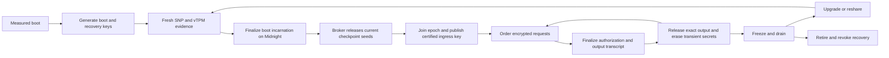

# Veritee hardening for the Fenrir signing committee

Design date: November 14, 2026. Committee: `n = 9`, Byzantine bound `f = 2`, signing and decryption threshold `t = 7`, board quorum `q = 6`.

## 1. Summary

Veritee uses **attestation-gated remote sealing with state transitions finalized on Midnight**. The same registration binds the approved software, logical committee member, active boot, storage checkpoint, and published encryption keys. A genuine VM with an approved image receives no authority merely because it boots successfully.

| Gap | Fix |
|---|---|
| No sealed storage | A Rust secret service encrypts every durable secret before it reaches `/mnt/persist`. Independent member-specific release brokers recover checkpoint keys only into an approved, currently registered boot. Signing nonces and committee-generated presignatures remain in RAM. |
| No rollback protection | Midnight records monotonically increasing boot incarnations, checkpoint roots, spent slots, and epoch transitions. Each security-sensitive output has a committed, immutable transcript before release. A restored node recovers exactly the current checkpoint or stops. |
| No offline encryption | Each member publishes a distinct, attested X25519 recipient key for an admission epoch. A wallet verifies a finalized directory, creates its envelope once, and leaves. An outer seven-of-nine threshold ciphertext hides the request until its order is fixed. |
| Secrets released by identity alone | A release requires fresh, verified SNP/HCL evidence, a nonce-bound vTPM quote, approved PCR4/PCR15 values, internally generated recipient keys, and a finalized boot authorization. Managed identity supplies service access, never the security decision. TLS keys originate inside the VM. |

The organizing rule is: **a key becomes usable only for a named state transition**. Encryption protects stored bytes. Attestation identifies the code that handles them. Midnight decides which version of that state can act. The release broker enforces that decision during recovery.

The first release favors safety over throughput. It waits for Midnight finality before releasing a signing partial, decryption share, or other irreversible protocol message. It batches independent operations, but never releases them before their batch is final. A later fast path requires a separately justified rollback-resistant service.

The design assumes correct approved guest code, intact hardware isolation for honest nodes, and independent member administration. It also requires Midnight finality and a fresh external ledger view. Cloud snapshots can survive deletion requests. Released signatures remain valid. A common hardware compromise can defeat the committee's TEE boundary.

Warden, contract, and co-custody implementations are unavailable. Their required behavior below is an interface contract, not a claim about deployed functionality. The existing `veritee-vm` checkout supplies the measured boot and channel foundation. These additions are not implemented by this document.

## 2. Gap one: sealed storage and erasure

### Threat and current boundary

A node operator exports or restores the plain ext4 persist partition and reads committee shares, accepted user dealings, or nonce state. File permissions do not protect a disk export. The current mount and application volume appear in `veritee-os/mkosi/rootfs/mkosi.extra/etc/fstab:6` and `projects/mpc-node/run.d/docker-compose.yml:64`. Terraform selects `VMGuestStateOnly`, not confidential OS-disk encryption, in `cli/deploy-azure-snp/main.tf:257`.

The trusted execution boundary is the entire confidential VM. Its kernel, measured setup, attestation server, container runtime, root hooks, and signer belong to the trusted computing base. A Unix socket separates processes operationally. It does not make a compromised guest kernel harmless.

### Best practice and the platform choice

Azure explicitly supports sealing to its vTPM. Its vTPM runs inside hardware-protected memory, rather than as an ordinary host-readable software TPM. However, Azure recovery preserves storage-hierarchy state, including NV state, in supported restore flows. Therefore a vTPM seal protects confidentiality but does not establish a counter outside the restore domain. Describing Azure's vTPM as freely editable by the host is inaccurate. Treating its counters as independently irreversible is also unjustified. [Azure vTPM](https://learn.microsoft.com/en-us/azure/confidential-computing/virtual-tpms-in-azure-confidential-vm), [sealing FAQ](https://learn.microsoft.com/en-us/azure/confidential-computing/confidential-vm-faq), [backup and restore semantics](https://learn.microsoft.com/en-us/azure/azure-sovereign-clouds/public/bcdr-impacts-sovereign-controls).

AMD's SNP key-derivation interface supports VCEK/VLEK or VMRK roots and selectable measurement, policy, SVN, and TCB inputs. Revision 1.59 also describes extended TCB inputs. These are derivation inputs, not application monotonic counters. On Azure, the hardware launch measurement covers the paravisor, while guest workload identity comes through vTPM measurements. The checkout uses HCL and explicitly avoids direct `/dev/sev-guest` access. Veritee therefore does not depend on `MSG_KEY_REQ` being exposed, on chip-bound recovery surviving host replacement, or on the paravisor measurement identifying the application. [AMD ABI, §7.2](https://docs.amd.com/api/khub/documents/NJQrpYY7KZGtlxDEdBGtzA/content), [Azure evidence design](https://learn.microsoft.com/en-us/azure/confidential-computing/guest-attestation-confidential-virtual-machines-design).

The chosen mechanism is remote sealing. Trustee supplies the useful separation between evidence appraisal and resource release policy. Its default acceptance of real TEE evidence is insufficient for Fenrir: release policy must name the workload and resource. Azure confidential disk encryption is additional protection, but application records still need authenticated encryption and external freshness. [Trustee policies](https://confidentialcontainers.org/docs/attestation/policies/), [Azure disk protection](https://learn.microsoft.com/en-us/azure/confidential-computing/confidential-vm-faq).

### Keys, records, and recovery

Each logical member `i` has its own release broker and HSM key namespace. Broker processes and administrative credentials are isolated between members. No broker or shared application master key can decrypt all nine members' storage. Compromise of a member's broker counts as compromise of that member, even if its signer VM remains intact.

The broker uses an RSA-3072 HSM wrapping key `W[i,g]`, where `g` is a storage generation. Azure Secure Key Release exports its private key only into the approved broker workload. The signer receives individual checkpoint seeds, never `W[i,g]`. Section 5 defines both release gates.

Use deterministic CBOR encoding for the following records. Reject duplicate map keys, unknown versions, noncanonical encodings, and oversized fields. Hashes use SHA-256. Protocol identifiers are fixed strings. Integers are unsigned 64-bit values unless a suite specifies otherwise.

```text
Context = {
  version: 1, midnight_genesis, contract_id, committee_id,
  member_id, storage_generation, share_epoch,
  object_id, object_version, schema_hash
}

seed       <- CSPRNG(32)
prk        = HKDF-Extract(SHA256(CBOR(Context)), seed)
record_key = HKDF-Expand(prk, "veritee/storage-record/v1", 32)
nonce      <- CSPRNG(12)
ciphertext = AES-256-GCM-SIV.Seal(record_key, nonce,
                                CBOR(Context), plaintext)
capsule    = RSA-OAEP-SHA256.Encrypt(W[i,g].public,
                                   seed || SHA256(CBOR(Context)))
Blob       = {Context, wrapping_key_version, nonce, capsule, ciphertext}
blob_id    = SHA256(CBOR(Blob))
```

Seeds are independent random values. They are not derived from the member's signing share, public measurements, or one permanent application secret. AES-GCM-SIV limits damage from accidental nonce reuse. It does not make replay safe. Split large records into bounded chunks, with chunk indices and total count included in their contexts. [RFC 8452](https://www.rfc-editor.org/rfc/rfc8452.html).

A checkpoint manifest lists the exact live blob identifiers and a Merkle root. It also commits to the schema, share epoch, accepted requests, and protocol-state cursor. The guest writes immutable blobs, synchronizes the files and directory, and replicates ciphertext to independent stores before committing the manifest root on Midnight. A commit requires six distinct storage receipts over the complete ciphertext manifest, giving at least four honest copies under `f = 2`. Those receipts attest availability, not plaintext correctness.

On recovery, the broker accepts only blobs included in the checkpoint currently authorized by Midnight. It decrypts the capsule, checks its context digest and HSM key version, and returns the seed encrypted to the active boot's attested recovery key. The node checks the returned grant and blob identity before opening the record. A missing current blob causes recovery failure. The broker never substitutes an older decryptable checkpoint.

Persistent ciphertext includes network share backups, live user dealings, and admission-epoch encryption keys that must survive a reboot. Committee-generated nonce and presignature pools are excluded. Line-dealing nonce shares supplied by an offline owner are persistent request material and obey the spent-slot rules in section 3.

### Erasure with an honest claim

The secret service uses zeroizing Rust types, preallocated secret buffers, explicit zeroization on completion and error paths, and guarded locked allocations. It disables swapping and hibernation, marks sensitive mappings `MADV_DONTDUMP`, sets `PR_SET_DUMPABLE=0`, and disables core dumps, kdump, and secret-bearing logs. Failure to establish the required memory protections prevents the signer from becoming ready. Python handles public orchestration, not secret scalars. `zeroize` prevents the intended overwrite from being optimized away, but does not erase prior copies or guarantee register clearing. [RustCrypto zeroize](https://docs.rs/zeroize/latest/zeroize/).

Deletion has three distinct effects:

1. The contract tombstones the object or slot, and brokers refuse further releases.
2. The running guest overwrites its plaintext and keys.
3. At storage-generation retirement, brokers destroy the obsolete HSM key and apply the defined backup-retention and purge procedure.

Only the third step, after all recoverable copies of the wrapping key disappear, supports cryptographic erasure of old capsules. A retained wrapping key plus an archived capsule still permits decryption by a compromised broker. An epoch recipient key also decrypts recorded requests from that epoch until it is destroyed. Veritee states this exposure explicitly.

VM destruction and a new hardware memory-encryption context reduce residual RAM exposure. A guest process restart or ordinary reboot is not treated as proof that the platform rotated every relevant key or destroyed a saved VM context.

### Behavior and limits

| Event | Storage behavior |
|---|---|
| Reboot | Generate new boot keys. Recover only the current authorized checkpoint. Abandon RAM-only nonce pools. |
| Redeploy | Enroll the new instance, fence the old incarnation, then release current checkpoint seeds to the new boot. No plaintext export through the operator. |
| Image upgrade | Authorize an exact old-to-new image transition. The new image reads only the authorized schema and writes a new storage generation. |
| Committee reshare | Create new share records and wrapping generations. Retire old records only after the handover and availability conditions hold. |

This stops disk inspection, unauthenticated modification, and cross-member blob substitution. It does not stop deletion, traffic analysis, malicious approved code, broker compromise, or recovery of secrets already extracted from memory.

## 3. Gap two: rollback and cloning

### Threat and best practice

A valid old ciphertext remains valid after rollback. A cloned VM can reuse a signing nonce, repeat a release, or retain a share after its logical retirement. A new image with the same measurements does not establish unique ownership of a committee slot.

ROTE places freshness outside one enclave's persistent state. Nimble provides an append-only service with explicit recovery and reconfiguration rules. Both make the relevant distinction: authenticated storage alone does not establish freshness. An Azure confidential ledger supplies append-only records, but adding another ledger does not automatically supply Fenrir's compare-and-swap semantics or independent freshness. Veritee uses the already required Midnight authorization chain as its durable authority. [ROTE](https://www.usenix.org/system/files/conference/usenixsecurity17/sec17-matetic.pdf), [Nimble](https://www.cis.upenn.edu/~sga001/papers/nimble-osdi23.pdf), [Azure confidential ledger](https://learn.microsoft.com/en-us/azure/confidential-ledger/overview).

### Authoritative records

The Midnight contract maintains these logical records. Private request fields are represented by hiding commitments and proofs, not plain hashes of guessable identities or transaction details.

```text
MemberState[committee, member] = {
  incarnation, boot_id, boot_signing_public, recovery_public,
  attestation_policy_hash, instance_binding,
  checkpoint_sequence, checkpoint_root, storage_generation,
  share_epoch, status
}

Slot[committee, request_tag, signing_generation, input_slot, purpose] = {
  epoch, transcript_commitment, selected_variant,
  participant_set_hash, state: COMMITTED | COMPLETE | ABORTED,
  authorization_reference
}

Vote[committee, member, request_tag, signing_generation] = {
  digest_commitment, output_commitment, replay_blob_id
}

MemberOutput[slot_id, member_id, round] = {
  incarnation, input_transcript_commitment,
  output_commitment, replay_blob_id
}

EpochState[committee] = {
  current_epoch, directory_hash, policy_version,
  freeze_position, handover_root, retired_epochs
}
```

`request_tag` is a uniformly random opaque identifier. The authorization proof binds it to the private request identity and prevents the same authorization from receiving a second spend allowance. The original line-dealing `rid` and its tombstones remain part of the private protocol state.

`incarnation` increases through an atomic contract update. `boot_id` is a fresh 256-bit random value generated inside the guest. Neither is the current `akx` counter. The contract admits one active incarnation per logical member. Enrollment binds that member to verified instance evidence and approved boot keys. An untrusted Azure tag, machine ID, or caller-supplied VM ID cannot perform enrollment.

### Commit before output

Every message whose duplication or equivocation can violate safety passes through the secret service. This includes PREVOTEs, signing partials, presignature protocol rounds, DKG/reshare messages, and threshold decryption shares. Consensus-signing state receives the same treatment when it resides in the VM.

```text
Transition = {
  domain: "veritee/transition/v1",
  committee_id, member_id, incarnation, boot_id,
  expected_checkpoint_sequence, expected_checkpoint_root,
  next_checkpoint_root, epoch,
  operation_id, slot_id, transcript_commitment,
  output_commitment, authorization_reference
}
```

The guest computes an output privately and stores its encrypted replay record. It submits a boot-signed transition. The contract checks current membership, the expected predecessor, the relevant slot, epoch status, and authorization. After finality, the guest releases only the output committed by that transition.

A PREVOTE first commits the member's own `Vote` record. It does not let that member consume the shared request slot. Creation of a shared `Slot` requires the protocol's valid quorum certificate and authorization proof. Each member then commits its own round output under `MemberOutput`; different members' valid shares are distinct outputs. A round record covers the entire recipient-specific message bundle. Consensus votes use the consensus protocol's height, view, and phase coordinates with its locking rules.

A retry either returns the identical recorded output or abstains. A second digest for a member's vote, or a second output for its occupied round record, is rejected. A shared slot cannot change its authorized transaction. An output commitment uses a fresh hidden salt where the output is not public.

Randomized multi-round signing requires an immutable input transcript and replay record for each round. A session identifier alone is insufficient. If the selected MPC library cannot resume with identical outputs, recovery aborts the session and consumes its nonce slots. No individual member can tombstone the request; request termination still requires the protocol's valid transition.

The launch path anchors the ordered board batch root on Midnight before threshold decryption. It also anchors safety-critical vote and output transitions before publication. Unanchored board certificates do not authorize secrets. The board still supplies efficient dissemination and six-vote certificates, but a rollback of its replicas cannot replace the finalized history used by the signer.

The quorum calculation remains exact: two six-member quorums intersect in at least `2 × 6 − 9 = 3` members, including an honest member when at most two are Byzantine. Seven shares are required to sign or decrypt. A six-vote certificate does not contain seven secret shares and does not prove seven honest holders.

### Nonces, crash points, and stale instances

Committee-generated nonce slots carry `(share_epoch, member, incarnation, boot_id, pool_id, slot_index)`. A fresh boot registers its identity before generating or advertising a pool. No RAM-only slot survives restart. An aborted slot never returns to the available pool.

Offline-owner line-dealing material has different recovery needs. Its original request and generation identify the slot across every boot. Once a PREVOTE or release binds that slot, recovery permits only the same transcript. Loss of the corresponding replay record causes abstention, not recomputation against a new message.

| Failure point | Recovery action |
|---|---|
| Ciphertext written, transition not final | Ignore orphan output. Never release it. |
| Transition final, response not sent | Recover and resend the exact recorded response, or abstain if it is unavailable. |
| Response sent, local completion marker lost | Finalized output record controls. A duplicate response adds no new capability. |
| Old disk restored | Its checkpoint root fails the current-state comparison. Fetch the exact current blobs or stop. |
| Two clones race | Only one expected-predecessor transition succeeds. Both can at most reproduce an already committed output. |
| Entire committee restored | Recover from Midnight and current broker state. Peer agreement among restored copies is insufficient. |

The system prevents conflicting authorized actions, not the physical existence of a second VM. An old instance that already holds a final output permit can still deliver that exact output. Freeze and retirement therefore stop new permits and account explicitly for in-flight permits. They cannot retract a valid native-chain signature.

### Freshness, bootstrap, and partitions

A finalized historical block proves history, not that it is the latest block. Brokers run independently synchronized Midnight verification and answer fresh random challenges. Initial boot activation includes the broker challenge in a newly finalized contract transaction. The node verifies the inclusion proof and the current member record before accepting a key grant.

This adds an explicit assumption: the broker and the chain synchronization path do not roll back together with the signer. The verifier has a trusted chain checkpoint and the chain-specific finality and synchronization rules. A Warden HTTP response or an old proof supplied by the operator is insufficient. During a partition, absent fresh authorization or new finality, the node stops issuing new secret-dependent outputs.

For reboot and redeploy, the contract increments the incarnation before recovery. For an image upgrade, it freezes admission, resolves in-flight operations, and authorizes the successor image. For reshare, it freezes the old share epoch and records handover before activating the new one. Checkpoint sequence numbers and tombstones never reset during these operations.

This mechanism stops rollback-driven nonce reuse and resurrection through compliant code. It does not repair a broken TEE that ignores the contract, a compromised authorization chain, or a threshold of already extracted shares. Arbitrary live-memory replay that changes execution is a hardware integrity failure, outside the intact-TEE argument.

## 4. Gap three: offline encryption to the committee

### Threat and best practice

An offline wallet cannot participate in the current interactive `akx` handshake. Its attested Ed25519 key signs handshakes, while recipient X25519 keys exist only for live sessions. Substituting a host-controlled public key would expose the owner's request before the committee sees it.

HPKE provides the recipient encryption primitive. It provides neither application replay prevention nor forward secrecy after recipient-key compromise. Oasis's accepted ephemeral-secret design demonstrates publishing enclave recipient keys and making key retention an explicit epoch decision. Ferveo demonstrates threshold encryption that delays decryption until order is committed. [RFC 9180](https://www.rfc-editor.org/rfc/rfc9180.html), [Oasis ephemeral secrets](https://docs.oasis.io/adrs/0021-keymanager-ephemeral-secrets/), [Ferveo](https://anoma.net/blog/ferveo-cryptography-overview).

### Attested key directory

Each node generates `ingress_sk[i,e]`, an independent X25519 private key, inside the secret service. It is distinct from its boot recovery key, `akx` signing key, board key, suite-curve line-dealing key, and threshold signing share. It persists through the remote-sealing mechanism until the admission epoch and its accepted requests have drained.

```text
Directory = {
  version: 1, midnight_genesis, contract_id, committee_id,
  epoch, n: 9, f: 2, signing_threshold: 7,
  decryption_threshold: 7, board_quorum: 6,
  admission_start_height, admission_end_height, drain_end_height,
  policy_hash, directory_sequence,
  members: [{member_id, ingress_key_id, ingress_public,
             dealing_suite_public, key_certificate_hash}],
  mempool_suite_id, mempool_public_key, dkg_transcript_hash,
  previous_directory_hash
}
```

Section 5's key certificate attests each recipient key's internal origin. A proof of possession confirms control of the private key. It does not independently prove that the key originated in a TEE. The finalized directory requires the configured governance approval and valid member certificates. An enrollment cannot register the same recipient key for two members.

A wallet pins the Midnight genesis, contract, governance policy, protocol suite, and a verified checkpoint. Before disconnecting, it obtains the directory, its finality proof, and the key certificates. It retains the highest accepted directory sequence. A wallet already offline with no authenticated directory cannot discover a current recipient key. The product promises one offline submission after this synchronization, not indefinite freshness without communication.

### Envelope format

Use HPKE Base mode with `DHKEM(X25519, HKDF-SHA256)`, `HKDF-SHA256`, and `AES-256-GCM`. The tuple of identifiers is `(0x0020, 0x0001, 0x0002)`. Generate fresh encapsulation randomness for every recipient.

```text
Header = {
  version: 1, committee_id, epoch, directory_hash,
  request_tag: random_32_bytes, admission_expiry_height,
  padding_class
}

info_i = CBOR(["fenrir/offline-node/v1", midnight_genesis,
               contract_id, directory_hash, member_id, ingress_key_id])

Body_i = {
  private_request_header, authorization_proof,
  original_owner_message_or_member_dealing,
  dealing_commitments, reply_public_key, padding
}

(enc_i, ct_i) = HPKE.SealBase(ingress_public[i], info_i,
                             CBOR(Header), CBOR(Body_i))
NodeEnvelope_i = {member_id, ingress_key_id, enc_i, ct_i}
Package = {Header, node_envelopes[9], common_private_payload}
```

The original dealing, its proof, and its suite-curve ciphertexts retain their existing validation semantics. X25519 HPKE is an outer transport envelope. It does not silently replace the line-dealing encryption scheme or its complaint proof.

The wallet places `Package` inside a separate seven-of-nine threshold encryption envelope under the directory's mempool key. The integration uses Ferveo's validated ciphertext, DKG, decryption-share, and combination interfaces, with the implementation version and serialization fixed by `mempool_suite_id`. The authenticated payload binds `Header`, the directory hash, and the complete package. This is a dependency to integrate and review, not an assertion that `veritee-vm` already implements Ferveo.

The public board stores only the outer ciphertext, opaque tag, epoch, size class, and admission metadata. Padding rounds messages into fixed size classes. Authentication and covenant terms remain inside. Application authorization comes from the private proof and dealing checks, not HPKE Base mode.

After a six-vote ordering certificate and final Midnight commitment to the batch, seven nodes produce valid threshold decryption shares. In TEE mode they send those shares over mutually attested channels to authorized signer instances. They never publish enough shares on the public board to reconstruct the plaintext. Each node then opens its own inner envelope, validates the dealing, and records acceptance before acknowledging it.

A recipient rejects a mismatched directory, node, key ID, epoch, context, expiry, or duplicate accepted request. Invalid ciphertext returns one uniform failure. Semantic nullifiers prevent rewrapping the same authorization under a new opaque tag. The committee remains online after the owner's one move.

### Epoch transitions and limits

A reboot recovers the same live admission key into the new authorized boot, so queued ciphertext remains usable. A redeploy transfers recovery authority through Midnight. An image upgrade retains a key only through an explicit transition permitted by the directory policy.

A new committee epoch publishes fresh ingress and mempool keys. Old keys receive no new admissions after their cutoff. Previously accepted requests either finish with the old epoch or become void under the owner's declared rule. They are not silently decrypted and reassigned to an arbitrary successor. The directory states the bounded drain period.

This provides offline addressing and pre-order confidentiality below seven decryption shares. Static recipient keys expose their epoch's recorded ciphertext if later compromised. Key expiry prevents new acceptance, but cannot reverse disclosure of an already created ciphertext. Padding reduces length leakage, not source-IP, timing, or target-chain linkage.

## 5. Gap four: attestation-gated secret release

### Threat and best practice

Managed identity identifies an Azure resource. It does not identify the software currently executing in that resource. The current `projects/templates/run.d/main:57` retrieves TLS secrets through managed identity, and Terraform grants `Key Vault Secrets User`. The operator can possess the uploaded TLS key.

Azure SKR gates exportable HSM keys on verified attestation claims. It does not attach the same policy to ordinary Key Vault secrets or certificates. AWS Nitro KMS likewise binds operations to attested image/PCR conditions. These systems establish the pattern: service identity and workload authorization are separate checks. [Azure SKR](https://learn.microsoft.com/en-us/azure/confidential-computing/concept-skr-attestation), [Azure policy examples](https://learn.microsoft.com/en-us/azure/confidential-computing/skr-policy-examples), [Nitro KMS conditions](https://docs.aws.amazon.com/kms/latest/developerguide/conditions-nitro-enclave.html).

A measured value only helps when the release policy checks it. The 2025 dstack audit documents a demo KMS that released keys without enforcing the measured compose hash. Veritee's policy checks the complete application identity and approved transition, including root hooks and egress configuration. [dstack audit, finding 04](https://docs.phala.com/images/audits/dstack-audit.pdf).

### Close the public key attestation oracle first

`server/azure_attestation_server/src/enclave_key.rs:40` attests the `akx` public key with the constant nonce `temenos-akx-v1-epoch`. The public handler in `main.rs:736` accepts caller-selected payloads through the same evidence generator. Evidence for a caller-selected public key proves that the VM processed those bytes. It does not prove that the VM owns the corresponding secret.

The new key-certificate endpoint accepts a verifier challenge and an internal key handle. It reads the public key from the secret service's own registry. It never accepts a supplied public key for certification. The generic diagnostic endpoint uses a separate evidence domain which all key verifiers reject. Every generic path, including legacy `akx` paths, applies that domain inside measured code.

```text
KeyDescriptor = {
  version: 2, purpose, committee_id, member_id,
  boot_id, incarnation, key_id, algorithm, public_key,
  application_root, os_release_digest, policy_hash,
  share_epoch, directory_epoch
}

binding = SHA256(CBOR(["veritee/key-certificate/v2",
                      verifier_challenge, KeyDescriptor]))

TPM_quote.extraData = binding
HCL_user_data       = binding || zero_32_bytes
KeyCertificate      = {KeyDescriptor, verifier_challenge,
                       SNP_report, endorsement_chain, HCL_runtime_data,
                       TPM_quote, quote_signature, PCR_values, event_log}
```

The collection service serializes HCL user-data writes, report reads, and quote collection. It verifies the result before returning it, preventing concurrent requests from mixing evidence. Azure SNP `REPORT_DATA` commits to the HCL runtime claims. The verifier checks that indirection and the runtime `HCLAkPub`, then verifies the quote under that same AK. It does not compare the raw report field directly with `binding`. [Azure HCL evidence format](https://learn.microsoft.com/en-us/azure/confidential-computing/guest-attestation-confidential-virtual-machines-design).

For MAA evidence, the verifier validates the JWT signature, pinned issuer, intended audience where present, lifetime, policy identity, and exact challenge binding. It still requires the nonce-bound workload quote and key-provenance checks. A signed `client_payload` alone is insufficient. Existing `get_quote(&[])` and `tpm2_quote` calls without qualifying data are replaced.

### Release policy

The broker evaluates this logical predicate over verified evidence and current ledger state. These are normalized verifier fields, not invented Azure JWT claim names.

```text
allow_checkpoint_seed_release =
  valid_platform_chain_and_signature
  AND supported_evidence_version
  AND expected_HCL_AK_and_quote_binding
  AND challenge_is_fresh_and_unused
  AND key_origin_is_internal
  AND release_OS_and_application_are_approved
  AND PCR4_matches_approved_UKI
  AND PCR15_matches_app_root_plus_this_boot_TLS_evidence
  AND platform_configuration_matches_approved_profile
  AND all_required_TCB_components_and_mitigations_pass
  AND SNP_debug_is_disabled
  AND migration_policy_matches_approved_profile
  AND no_debug_or_unmeasured_guest_control_path
  AND member_is_active_in_finalized_state
  AND recipient_boot_and_incarnation_match
  AND requested_blob_is_in_authorized_checkpoint
  AND storage_generation_and_share_epoch_are_live
  AND requested_operation_is_permitted
```

PCR15 is reconstructed from its complete extension sequence. It is not compared with one permanent number, because the in-VM TLS key changes across boots. PCR0–3 and the paravisor identity come from a reviewed platform profile. Operator hydration is not an approval authority.

The launch profile disables migration-agent association and guest debug. It also requires an approved guest kernel and measured configuration for host-controlled exception handling. Any Azure SKU that cannot expose the required evidence or meet the profile is ineligible. Secure Boot is enabled once the signed UKI deployment path is qualified. The current `secure_boot_enabled=false` profile cannot pass a policy that requires it.

The broker uses its trusted clock for a 60-second challenge window and rejects MAA tokens older than five minutes or beyond their own expiry. Those are initial operational parameters. Ledger transitions, rather than guest wall-clock leases, determine signing authority. Certificate and revocation collateral are refreshed under a bounded policy.

### Two release gates and the bootstrap

The HSM gate protects `W[i,g]`. It pins the broker's attestation authority, measured release image, application identity, and supported platform claims. Claim paths and encodings are tested against real AzureGuest tokens. Missing workload claims fail enrollment rather than degrading to an `azure-compliant-cvm`-only rule. The release response is wrapped to the broker's attested recipient key.

The broker gate protects checkpoint seeds. It independently verifies the signer certificate, then checks Midnight membership, incarnation, checkpoint, and revocations. It returns:

```text
Grant = {
  member_id, boot_id, incarnation, blob_id,
  storage_generation, checkpoint_sequence, checkpoint_root,
  policy_hash, activation_transaction, challenge
}
Response = HPKE.SealBase(recovery_public,
                        "veritee/checkpoint-release/v1",
                        CBOR(Grant), seed)
```

The response is authenticated by the broker channel and bound to its signed grant. The node verifies both. Neither managed identity nor a captured grant permits changing the recipient.

Broker bootstrap uses its pinned deployment identity and HSM release policy. The signer boots without committee secrets, generates recovery and signing keys, attests, finalizes its boot activation, and only then recovers. First deployment has an empty checkpoint and runs the selected DKG inside attested participants. This avoids requiring an existing committee share to unlock the first committee share.

Compute identities receive no direct HSM decrypt/unwrap permissions and no ordinary secret-read path for committee material. Release policies are immutable for each key version. Root administrators capable of granting alternate private-key operations remain trusted per-member custodians. Their compromise counts toward the member fault bound. A shared administrator over seven namespaces defeats the intended separation and is prohibited.

TLS private keys are generated inside the VM. Internal Caddy TLS supplies the initial key and evidence. Public certificate issuance uses an in-VM CSR when needed. Reboot makes new TLS and boot keys. Redeploy requires a new instance enrollment. Upgrade requires an exact successor approval. Reshare changes resource eligibility and retires old key versions. None of these paths falls back to managed-identity-only retrieval.

## 6. How the four fixes form one node lifecycle



1. **Boot.** Verify the immutable OS and application. Install the measured egress rules. Start the secret service with locked memory and no plaintext persistence path.
2. **Attest.** Generate fresh boot, recovery, and TLS keys. Obtain challenge-bound evidence with the complete PCR chain and internal key provenance.
3. **Obtain secrets.** Finalize the new incarnation. The broker releases seeds for the current checkpoint. Recover its exact state, apply all later tombstones, and abandon previous boot nonce pools.
4. **Join epoch.** Verify the member roster and governance policy. Complete DKG or approved recovery. Publish the ingress certificate and confirm the finalized directory.
5. **Receive dealings.** Accept only ciphertext admitted under that directory. Wait for finalized order before threshold decryption. Validate the private authorization, original dealing, and share commitments. Persist acceptance before ACK.
6. **Sign or release.** Build the transaction locally. Verify the authorization proof and six-vote lock. Commit the exact slot and output transcript. Seven valid signing shares produce the native signature.
7. **Erase.** Delete transient nonce material and plaintext buffers after the committed output. Record completion and tombstones. Retain only the ciphertext needed for permitted exact retransmission.
8. **Upgrade.** Freeze new work, resolve in-flight permits, approve the successor, and migrate the current checkpoint. Increment the incarnation and storage generation. Never activate the predecessor again as a recovery shortcut.
9. **Retire.** Stop admission, finish or void remaining requests, revoke broker recovery, erase live keys, and destroy retired wrapping generations under the retention policy.

Liveness needs seven available signers and decryptors, six board votes, working release services for recovering members, and Midnight finality. With two withholding members, all seven honest members are needed. A third unavailable member stops threshold operations. An unavailable current checkpoint also stops that member until reconstruction or approved reshare.

## 7. Use by the signing committee

### Sealed user dealings and authorization

Hardening preserves the owner's one move and the original line-dealing checks. It changes where sensitive bytes live and how a node proves that a slot is unused. It does not replace a user's sealed contribution with a generic instruction to a TEE signer.

For sealed variants, the selected variant and its sighash enter the finalized release transcript. A replay returns the same partial. An authorized fee bump uses the next permitted generation and variant, all spending the same pin. Multiple variants can therefore be released over time, but conflicting release choices within one generation are forbidden. The native chain's conflicting-input rule supplies the one-spend property.

In the co-custody extension, the address key remains jointly controlled by the user's element and the distributed Fenrir element. The secret service contains only the node's network share and the user's limited request contribution. A broker never receives a complete address key. The selected co-custody signing protocol must establish that composition cryptographically.

The Midnight authorization proof binds the opaque request tag to the transaction commitment, charter version, approver state, and legal-hold state. It also binds the admitted route: principal intent, authorized seizure/default, or standing exit. The signer verifies the exact transaction preimage against that commitment. The finalized release authorization is the policy decision point. A later freeze stops future authorizations, but cannot invalidate a signature already authorized and released.

### Threshold-encrypted mempool and operator blindness

Separate keys protect storage, offline node delivery, mempool decryption, and asset signing. Compromise of one role does not automatically expose the others through key reuse.

Before ordering, fewer than seven mempool shares cannot decrypt under the selected threshold scheme's assumptions. After ordering, TEE mode reconstructs plaintext only inside authorized VMs. Public decryption shares, plaintext board posts, verbose complaints, and content-bearing telemetry are excluded. Public complaint evidence must use a privacy-preserving proof or remain inside the confidential committee. The original public complaint containing a DH value is not a privacy-preserving error report.

The host still sees traffic volumes, timing, endpoints, restarts, and eventual public-chain transactions. Relays, batching, padding, and private application proofs reduce this leakage. They do not establish deposit-to-egress unlinkability by themselves.

### Presignatures and reshare

New threshold-signing presignatures are RAM-only and boot-scoped. Existing user-dealt lines remain recoverable but permanently bind to their original slots and committed digests. The service never exposes a raw-hash signing endpoint.

Long-lived Fenrir network shares rotate through an audited verifiable reshare protocol that preserves the public address key. The handover transfers request tombstones and slot commitments as well as shares. Old and new committees share one finalized cutoff. Pending presignatures do not migrate.

A six-node READY certificate is insufficient to guarantee seven usable shares after two Byzantine recipients withhold. Activation requires either nine recipient acknowledgments, or a verified recovery construction that makes valid encrypted shares available to every new recipient. The latter must guarantee that all seven honest recipients can recover and validate their shares. Until that construction is established, the conservative all-nine handover can stall and the old committee remains authoritative.

The existing `SCHEME.md` T2 profile permits only `finish` and `void`. Its pending line dealings do not acquire `reshare` support through encrypted storage. V1 drains or voids those requests. Extending T2 request resharing is a separate cryptographic change with its own proof and availability argument.

### Guarantees that still require cryptography

| Guarantee | Required basis when a TEE fails |
|---|---|
| No complete address key at one node | DKG, threshold signing, and the user's separate co-custody contribution. |
| No new unauthorized sealed transaction, even with all committee nodes corrupt | A cryptographically constrained user contribution covering only the enumerated conflicting transactions. Existing sealed line dealing supplies this property for its original full-key setting, not automatically for a new composition. |
| No early mempool opening below seven shares | Threshold encryption, valid-share proofs, and independent share custody. |
| No equivocation with at most two Byzantine members | BFT agreement, signature verification, and durable slot rules. A seven-share threshold alone does not establish the two-fault policy bound. |
| Hidden plaintext after ordering in non-TEE mode | MPC or another private-computation construction. Decrypting into ordinary node processes does not satisfy operator blindness. |
| Charter enforcement against every custodian colluding | Cryptographic authorization in the co-custody construction or native-chain enforcement. A TEE policy cannot establish this universal claim. |
| Safe adaptive corruption across epochs | A proven proactive protocol, bounded corruption per refresh interval, and its erasure assumptions. Static-corruption results do not extend automatically. |

The TEE and non-TEE modes retain the same directory, ciphertext, request commitments, authorization proofs, and slot identifiers. Non-TEE mode replaces trusted plaintext processing with the required cryptographic computation. Recovery and exit when Fenrir disappears remain custody-protocol responsibilities, not consequences of these four fixes.

## 8. Implementation plan for `veritee-vm`

Estimates are engineering estimates, not measured performance. They exclude implementing a new threshold-signing or threshold-encryption primitive.

| Order | Files and components | Size estimate | Acceptance condition |
|---|---|---:|---|
| 1 | Add evidence-v2 types and a shared verifier in `server/attestation_verifier/`. Change `server/azure_attestation_server/src/main.rs`, `enclave_key.rs`, `vtpm.rs`, and `eph_key_tpm.rs`. | 2–4 kLOC | Fresh quote challenge, complete HCL/AK chain, internal key provenance, and strict evidence parsing. |
| 2 | Add `server/secret_service/` with key registry, encrypted blobs, locked-memory ownership, and operation-specific APIs. Update `server/akx/src/epoch.rs`, `session.rs`, and `record.rs` for key hygiene and v2 identity binding. | 3–5 kLOC | No raw secret export, no persisted presignature pool, uniform failure behavior. |
| 3 | Add `server/state_guard/` and a Midnight proof adapter. Integrate checkpoint CAS, boot incarnation, per-slot transcripts, and exact-output replay. | 3–5 kLOC | Restore, fork, and crash schedules cannot produce two transcripts for one slot. |
| 4 | Add isolated release-broker deployment and SKR adapter, with one HSM namespace per member. Change `cli/deploy-azure-snp/main.tf` and remove the signer secret-read grants. | 2–3 kLOC plus infrastructure | Broker and signer gates both deny mismatched images, stale state, and alternate recipients. |
| 5 | Change `veritee-os/measured_setup/main.py`, `veritee-os/mkosi/rootfs/mkosi.conf.j2`, fstab, mount-persist, and service units. Change `server/guest_attestation/veritee_attestation/document.py` and `tpm_quote.py`. | 1–2 kLOC | Boot ordering, memory controls, PCR15 replay, in-VM TLS, and restricted egress work on Azure. |
| 6 | Add directory and offline-envelope client modules under `cli/veritee/`. Add ciphertext ingestion and threshold-encryption adapter. Update `projects/mpc-node/metadata.json` and `run.d/docker-compose.yml`. | 2–4 kLOC | One wallet message survives a signer restart and remains unreadable before committed order. |
| 7 | Integrate signer slot APIs, DKG/reshare, and checkpoint migration in the actual MPC application repository. Update the two attested-channel documents and operator recovery procedure. | 3–5 kLOC integration | No direct filesystem or network path bypasses the secret service's output gate. |
| 8 | Add model-based schedules, negative evidence fixtures, fault injection, and real Azure lifecycle tests. | 3–5 kLOC tests | All launch gates below pass, including two-member outage and stale-image rejection. |

The total is roughly 19–33 kLOC including tests, plus external contract work. A small team needs several engineer-months and an independent security review. The dominant uncertainty is the Midnight proof/contract integration and the selected MPC library's crash semantics.

Specific changes follow from the checkout:

- Replace the constant-nonce key attestation, and reject legacy v1 key certificates for new secret release.
- Give all quote collectors qualifying data and verify it on the client and broker. Keep static `attestation.json` explicitly diagnostic.
- Replace `next_boot_epoch()` as a security identity with the contract incarnation and random boot ID.
- Remove plaintext `/mnt/persist/mpc-node:/data` access for secret state. Expose the secret service through a credential-checked local socket with typed operations.
- Correct `compute-pcr15.py` to match the actual application-root, zero, and TLS extension sequence.
- Replace the MPC node's `unrestricted` egress profile with measured destinations for Midnight, attestation, brokers, peer channels, and required chain access. Add only the ciphertext-ingest proxy paths that the application uses.
- Keep all behavioral configuration and hooks under measured image identity. Reject mutable boot-time configuration that changes signing or release policy.

### Warden and Midnight additions

Warden reproduces the exact OS/application combination, publishes its measurement manifest, and records the verifier policy version. It supports evidence v2, records key certificates, and checks platform advisory requirements. It does not approve its own new image or control all member recovery keys.

Midnight adds the member, checkpoint, slot, directory, freeze, and handover state machines specified above. Updates use atomic predecessor checks. Governance uses seven of nine separately controlled governance approvals for new images, new member-instance enrollment, recovery-policy changes, and successor transitions. Routine boot renewal within an existing approved enrollment uses fresh evidence and the registered release policy. Governance keys are distinct from signing, board, and boot keys.

Contracts verify authorization proofs and store hiding commitments. Large ciphertexts remain off-chain with committed roots and availability receipts. The chain adapter supplies authenticated inclusion and finality proofs. If Compact cannot verify a required external signature directly at acceptable cost, a reviewed proof circuit verifies it and binds the public inputs. No unauthenticated Warden assertion substitutes for that verification.

### Required tests

1. **Attestation substitution:** obtain generic evidence for an attacker key. Verify rejection as a key certificate. Mix AKs, quotes, report data, challenges, and PCR arrays across VMs.
2. **Policy denial:** test debug images, altered hooks, old kernels, incorrect PCR15 ordering, weak platform profiles, revoked measurements, missing claims, expired tokens, and wrong HSM recipient keys.
3. **Disk exposure:** inspect checkpoint files and exported test disks for known plaintext markers and private-key material. Mutate and transplant records across members, generations, and contracts.
4. **Crash consistency:** stop execution before and after file synchronization, replication, contract finality, output transmission, and erasure. Check identical retransmission or abstention.
5. **Forking:** launch two copies of the same saved state. Race conflicting votes, variants, and MPC transcripts. Reject each member's conflicting retry while accepting distinct valid member outputs. A single bad PREVOTE cannot consume the shared slot or tombstone the request.
6. **Global rollback:** restore all signer disks and present old signed checkpoints. Fresh broker challenges and new finalized activation must prevent stale recovery. Test isolation from current chain access and require a stop.
7. **Offline delivery:** encrypt with a verified directory, reboot or redeploy recipients, and deliver later. Test stale epochs, replay, wrong member keys, malformed threshold shares, and expiration during handover.
8. **Reshare:** verify unchanged address public keys, unavailable recipients, old-epoch exclusion, slot preservation, and the all-nine READY rule. Confirm T2 pending requests only finish or void.
9. **Memory and leakage:** verify swap/dumps are disabled, locked-memory failures prevent readiness, and errors/logs do not disclose requests. Inspect secret ownership and zeroization paths rather than claiming a test proves physical erasure.
10. **Availability and cost:** run with two withholding members, one additional outage, broker failures, and Midnight stalls. Measure finality-dominated latency, batching, storage growth, and HSM recovery cost.

Unit tests and mocks do not establish Azure's actual quote claims, restore behavior, or firmware deployment. Real CVM tests are a release requirement. This document reports a design and source review, not executed implementation tests.

## 9. Residual risks and known attacks

### Remaining authority

An Azure tenant operator can stop VMs, withhold disks, manipulate traffic and untrusted metadata, replay stored ciphertext, and force recovery attempts. Under the stated assumptions, those actions cause rejection or loss of availability rather than a new signature. A malicious Azure host operator additionally controls scheduling and host interfaces and can exploit platform vulnerabilities.

A malicious image builder can produce perfectly reproducible malicious code. Reproduction establishes identity, not benevolence. Exact image approval, independent review, and governance separation therefore remain security assumptions. An approved exfiltration path can defeat sealing and attestation together.

AMD controls the hardware and firmware root. Microsoft controls Azure's paravisor, attestation services, managed HSM implementation, and platform deployment. Compromise of those roots can defeat the evidence or extract secrets. Nine Azure VMs do not create nine independent hardware trust roots. The same vulnerability or administrator can affect several members at once.

Broker compromise exposes one member's recoverable history within its key-retention window. A compromised shared administrator, seven member roots, or a common broker vulnerability can expose the threshold. Restoring old HSM backups must never restore retired authorization. Rotation of a wrapping key does not invalidate a signing share already stolen.

### Attack consequences

| Attack | Relevant result | Consequence for Veritee |
|---|---|---|
| CacheWarp | Selective stale-memory faults undermine guest execution on affected SEV systems. | A disk counter cannot repair corrupted execution. Require mitigated platforms and treat successful exploitation as a Byzantine member. |
| WeSee and the Ahoi family | Malicious notifications and exception handling cross the host/guest boundary. | Include guest-kernel and paravisor handling in the approved profile. An attested vulnerable image remains vulnerable. |
| BadRAM | Memory aliasing enables replay and attestation compromise on affected systems. | Check platform mitigation requirements. A hardware signature alone is insufficient if the implementation that creates it is compromised. |
| Heracles, CCS 2025 | Chosen-plaintext behavior in deterministic memory encryption exposes guest secrets. | Require applicable ciphertext-hiding and platform mitigations. Constant-time application code alone does not establish protection. |
| TEE.fail, disclosed in 2025 and published at S&P 2026 | Physical DDR5 interposition extracts secrets, including Intel attestation keys, and attacks SNP with ciphertext hiding. | Treat physical host access and forged attestation as concrete risks. Do not attribute the demonstrated Intel attestation-key extraction specifically to AMD. |
| Fabricked, 2026 | Fabric routing misconfiguration undermines SNP integrity. | Check platform firmware as well as reported TCB. AMD's revised advisory lists no attestation TCB value for this mitigation. |
| AMD-SB-3038 and AMD-SB-3054, November 2026 | Disclosed faults include derived-key exposure, guest-context integrity failures, and RMP-protection bypass. | A static 2025 minimum is obsolete. Evaluate CPU-specific firmware, mitigation bits, and unavailable evidence before admitting a node. |

Sources for these results: [CacheWarp](https://cachewarpattack.com/), [WeSee](https://ahoi-attacks.github.io/wesee/), [Ahoi](https://ahoi-attacks.github.io/), [BadRAM](https://badram.eu/), [Heracles](https://heracles-attack.github.io/), [TEE.fail](https://tee.fail/), [Fabricked](https://xca-attacks.github.io/fabricked/), [AMD-SB-3034](https://www.amd.com/en/resources/product-security/bulletin/amd-sb-3034.html), [AMD-SB-3038](https://www.amd.com/en/resources/product-security/bulletin/amd-sb-3038.html), [AMD-SB-3054](https://www.amd.com/en/resources/product-security/bulletin/amd-sb-3054.html).

The policy manifest records a CPU-family-specific minimum for each TCB component and each required mitigation. It separately records platform requirements that attestation cannot prove. For example, AMD-SB-3054 names different SNP values for Milan and Turin. Those values are advisory-specific requirements, not a complete platform safety certificate. Where Azure exposes no adequate evidence for a mandatory mitigation, the deployment either depends explicitly on a provider assurance or remains ineligible.

External state prevents replay of authorized actions while the executing code and verifier remain honest. It cannot stop an extracted seven-share coalition from signing outside that code. The user's cryptographically limited contribution, threshold protocols, and native-chain rules remain the final protection against that failure.

## 10. Sources

All URLs below were opened. Vendor documents describe interfaces and stated guarantees. Attack project pages describe the researchers' results. The mechanisms and estimates in this document are design decisions unless attributed otherwise.

### Local grounding

- [Veritee model](/home/hoskinson/Projects/mpcexperiments/design/enhancement/VERITEE-MODEL.md): measured boot, persistence, attestation, key handling, and missing companion-repository boundaries.
- [Hardening brief](/home/hoskinson/Projects/mpcexperiments/design/enhancement/BRIEF-VERITEE.md) and [protocol brief](/home/hoskinson/Projects/mpcexperiments/design/enhancement/BRIEF.md): task scope, committee parameters, co-custody, and blindness requirements.
- [SCHEME.md](/home/hoskinson/Projects/mpcexperiments/design/SCHEME.md) and [FACTS.md](/home/hoskinson/Projects/mpcexperiments/requirements/catalogue/FACTS.md): six-vote versus seven-share thresholds, sealed guarantees, restore rules, and the T2 reshare restriction.
- [Repository instructions](/home/hoskinson/Projects/veritee/veritee-vm/AGENTS.md), [graph report](/home/hoskinson/Projects/veritee/veritee-vm/graphify-out/GRAPH_REPORT.md), and targeted graph traversal: component locations and deployment constraints. Code checks, rather than inferred graph edges, establish the implementation findings.
- [Attestation server](/home/hoskinson/Projects/veritee/veritee-vm/server/azure_attestation_server/src/main.rs), [key endpoint](/home/hoskinson/Projects/veritee/veritee-vm/server/azure_attestation_server/src/enclave_key.rs), [akx epoch key](/home/hoskinson/Projects/veritee/veritee-vm/server/akx/src/epoch.rs), and [MAA claim types](/home/hoskinson/Projects/veritee/veritee-vm/server/azure_attestation_server/src/maa_jwt.rs): evidence paths, constant nonce, caller-selected payloads, empty quote challenges, and boot counter.
- [Measured setup](/home/hoskinson/Projects/veritee/veritee-vm/veritee-os/measured_setup/main.py), [quote collector](/home/hoskinson/Projects/veritee/veritee-vm/server/guest_attestation/veritee_attestation/tpm_quote.py), [fstab](/home/hoskinson/Projects/veritee/veritee-vm/veritee-os/mkosi/rootfs/mkosi.extra/etc/fstab), and [persist layout](/home/hoskinson/Projects/veritee/veritee-vm/veritee-os/mkosi/combined.repart/30-persist.conf): PCR extensions and unencrypted persistent storage.
- [Azure deployment](/home/hoskinson/Projects/veritee/veritee-vm/cli/deploy-azure-snp/main.tf), [TLS provisioning](/home/hoskinson/Projects/veritee/veritee-vm/projects/templates/run.d/main), [MPC compose](/home/hoskinson/Projects/veritee/veritee-vm/projects/mpc-node/run.d/docker-compose.yml), [MPC metadata](/home/hoskinson/Projects/veritee/veritee-vm/projects/mpc-node/metadata.json), and [service unit](/home/hoskinson/Projects/veritee/veritee-vm/services/attestation_server.service): managed-identity release, mount paths, unrestricted egress, and boot behavior.
- [Attested-channel implementation plan](/home/hoskinson/Projects/veritee/veritee-vm/docs/attested-channel-implementation-plan.md) and [TLS/channel threat model](/home/hoskinson/Projects/veritee/veritee-vm/docs/tls-channel-binding.md): intended channel design and documented limits.

### Public sources

1. [AMD SNP ABI revision 1.59, August 2026](https://docs.amd.com/api/khub/documents/NJQrpYY7KZGtlxDEdBGtzA/content): derived-key inputs, root selection, and attestation structure. The [revision landing page](https://docs.amd.com/v/u/en-US/56860_PUB_SEV_SNP) identifies the current revision.
2. [Azure confidential VM FAQ](https://learn.microsoft.com/en-us/azure/confidential-computing/confidential-vm-faq): vTPM sealing support and disk-encryption scope.
3. [Azure virtual TPM architecture](https://learn.microsoft.com/en-us/azure/confidential-computing/virtual-tpms-in-azure-confidential-vm): protected vTPM placement and measured boot.
4. [Azure guest-attestation design](https://learn.microsoft.com/en-us/azure/confidential-computing/guest-attestation-confidential-virtual-machines-design): workload versus paravisor measurements, AK binding, and HCL report-data indirection.
5. [Azure BCDR guidance](https://learn.microsoft.com/en-us/azure/azure-sovereign-clouds/public/bcdr-impacts-sovereign-controls): preserved storage-hierarchy state and refreshed endorsement identities during recovery.
6. [Azure Secure Key Release](https://learn.microsoft.com/en-us/azure/confidential-computing/concept-skr-attestation): HSM-backed key export under attestation policy and exclusion of ordinary secrets/certificates.
7. [Azure SKR policy examples](https://learn.microsoft.com/en-us/azure/confidential-computing/skr-policy-examples): platform, VM identity, and PCR claim examples. Exact claim mapping requires live-token validation.
8. [Trustee architecture](https://confidentialcontainers.org/docs/attestation/) and [policies](https://confidentialcontainers.org/docs/attestation/policies/): separate appraisal, reference values, and resource authorization.
9. [Nitro Enclaves KMS conditions](https://docs.aws.amazon.com/kms/latest/developerguide/conditions-nitro-enclave.html): image/PCR-specific operation authorization as corroborating practice.
10. [dstack audit, May–June 2025](https://docs.phala.com/images/audits/dstack-audit.pdf): the measured-but-unchecked compose-hash failure in finding 04. This is a finding about the audited demo configuration, not every current dstack deployment.
11. [Oasis key-manager policies](https://docs.oasis.io/core/consensus/services/keymanager/): threshold-approved enclave access and replication policy.
12. [Oasis accepted ephemeral-secret ADR](https://docs.oasis.io/adrs/0021-keymanager-ephemeral-secrets/): published enclave X25519 keys and the availability cost of erasing epoch secrets.
13. [ROTE, USENIX Security 2017](https://www.usenix.org/system/files/conference/usenixsecurity17/sec17-matetic.pdf): rollback and fork protection using external participating platforms.
14. [Nimble, OSDI 2023](https://www.cis.upenn.edu/~sga001/papers/nimble-osdi23.pdf): append-only freshness and explicit reconfiguration. Its benchmarks are not used as Veritee performance estimates.
15. [Azure confidential ledger](https://learn.microsoft.com/en-us/azure/confidential-ledger/overview): append-only ledger service, considered as an additional dependency rather than selected as the authority.
16. [RFC 9180](https://www.rfc-editor.org/rfc/rfc9180.html): HPKE suite, context binding, replay limitations, and recipient-compromise exposure.
17. [RFC 8452](https://www.rfc-editor.org/rfc/rfc8452.html): AES-GCM-SIV for stored records.
18. [RustCrypto zeroize](https://docs.rs/zeroize/latest/zeroize/): overwrite guarantees and limitations concerning copies, allocations, and registers.
19. [Ferveo cryptography overview](https://anoma.net/blog/ferveo-cryptography-overview): threshold encryption, DKG, ciphertext validation, and ordering before decryption. This design still requires implementation pinning and review.
20. [CacheWarp](https://cachewarpattack.com/): selective stale-memory faults and mitigation context.
21. [WeSee](https://ahoi-attacks.github.io/wesee/) and [Ahoi](https://ahoi-attacks.github.io/): hostile notifications and guest-handler compromise.
22. [BadRAM](https://badram.eu/): memory aliasing, replay, and attestation compromise.
23. [Heracles](https://heracles-attack.github.io/): chosen-plaintext leakage against SNP memory encryption.
24. [TEE.fail](https://tee.fail/): DDR5 physical interposition and the limits of hardware attestation trust.
25. [Fabricked](https://xca-attacks.github.io/fabricked/) and [AMD-SB-3034](https://www.amd.com/en/resources/product-security/bulletin/amd-sb-3034.html): routing integrity failures and mitigation evidence not captured by a TCB value.
26. [AMD-SB-3038](https://www.amd.com/en/resources/product-security/bulletin/amd-sb-3038.html) and [AMD-SB-3054](https://www.amd.com/en/resources/product-security/bulletin/amd-sb-3054.html): November 2026 requirements affecting derived keys, guest contexts, and SNP integrity.
