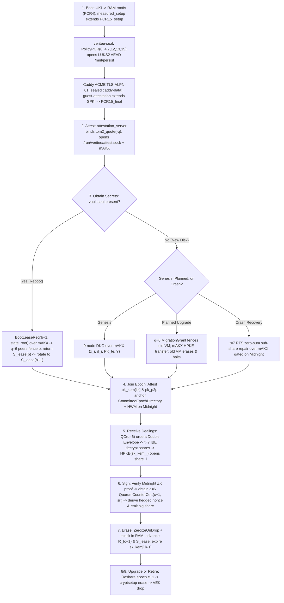

# Hardening Veritee for a Fenrir Threshold-Signing Committee

**Target system:** Veritee Confidential VM runtime ([veritee-vm](file://~/Projects/veritee/veritee-vm/README.md)) on Azure AMD SEV-SNP (`n = 9, f = 2, board quorum q = 6, key threshold t = 7`).
**Companion-repository assumptions:** `veritee-warden`, `veritee-smart-contracts` (Midnight Compact contracts), and `veritee-attestation-verifier-ts` are external to `veritee-vm`. This design assumes Midnight provides finalized state proofs over Compact contract ledger state, and that Warden verifies raw SEV-SNP VCEK chains, HCL runtime data, and vTPM quotes before submitting transactions to Midnight. Section 5 specifies every contract and Warden addition required.

---

## 1. Summary

Veritee today isolates guest memory in an AMD SEV-SNP Confidential VM, verifies its root and application filesystems with `dm-verity` (`PCR4` and `PCR15`), restricts outbound traffic through a measured proxy, and establishes interactive sessions with an attested per-boot Ed25519 key (`akx`). Four gaps prevent running a stateful threshold-signing node inside it: persistent storage is unencrypted ext4 with no memory zeroization; nothing detects disk or vTPM state rollback or VM cloning; clients cannot encrypt to an enclave offline; and secrets enter the VM from Azure Key Vault via unattested managed identity, including an operator-uploaded TLS private key.

### The One Design Idea: Quorum-Leased, Registry-Governed Enclave Identity

On Azure SEV-SNP Confidential VMs, **no single-host primitive can anchor secret continuity**. Microsoft's OpenHCL paravisor runs at VMPL0 and hides `/dev/sev-guest`, so guest applications cannot call AMD's `MSG_KEY_REQ` (`SNP_GET_DERIVED_KEY`), and the hardware `LAUNCH_MEASUREMENT` measures OpenHCL rather than the Veritee OS or DApp. Meanwhile, the vTPM lives inside OpenHCL and persists its NVRAM in the host-stored `VMGS` blob: the Azure subscription operator can snapshot and restore `(VMGS, OS disk)` together to roll back vTPM counters, clone both to fork a live signer, or wipe both on every immutable redeploy. Finally, Azure Key Vault trusts subscription IAM roles rather than code measurements.

The fix is to **move secret release, state continuity, and public-key discovery out of single-host Azure state and anchor them in the `(n = 9, f = 2, q = 6, t = 7)` enclave quorum governed by the Midnight `CommitteeRegistry` contract**:

1. **Gap 1 — Two-Factor Sealed Storage & Cryptographic Erasure:** Format `/mnt/persist` at first boot with `LUKS2` authenticated disk encryption (`dm-crypt` + `dm-integrity`, `aes-256-gcm`) keyed by a vTPM `PolicyPCR`-sealed key `K_vtpm` bound to the deterministic pre-TLS measurement state (`PCR0..4,7,12,13,15`). Inside `/mnt/persist`, wrap all signing shares, decryption shares, and nonce seeds in an application vault (`vault.seal`) encrypted under `HKDF(K_local_wrap || S_lease(b))`—combining local vTPM sealing (`K_local_wrap` derived from `K_vtpm`) with an in-RAM-only **Quorum Boot Lease secret `S_lease(b)`** held as `(6, 9)` Shamir shares by peer enclaves—and encrypt one-time presignature and dealing slots inside the vault under a per-operation hash ratchet `R_c`. Enforce `ZeroizeOnDrop`, `mlock`, `MADV_DONTDUMP`, `PR_SET_DUMPABLE=0`, and zero swap across all Rust secrets; consume one-time nonces and retired shares by advancing `R_c` and rotating `S_lease(b)` so historical disk blocks become permanently undecryptable.
2. **Gap 2 — Two-Speed Quorum State Continuity:** Replace non-existent local counters with a fast **Peer-Quorum Monotonic Lease (`q = 6` of `9`)** backed by slow **Midnight Epoch Anchors**. Every boot increments `boot_gen` and fences prior instances; every signature share or sealed-variant release requires a `q = 6` `QuorumCounterCert` over `(epoch, boot_gen, counter, state_root)`. Because any two quorums of 6 out of 9 overlap in at least `6 + 6 - 9 = 3 >= f + 1` nodes, at least one honest enclave rejects any rolled-back disk or cloned VM before `vault.seal` can open or derive a signing nonce.
3. **Gap 3 — Double-Envelope Offline Attested Encryption:** Publish a Midnight-anchored `CommitteeEpochDirectory` containing one **BLS12-381 Threshold IBE public key `PK_te`** (`t = 7` of `9`) for the committee and nine **attested static X25519 HPKE public keys `pk_kem[1..9]`** generated inside each MPC enclave, attested via `RawSevSnp`, and retained for a 2-epoch grace window. An offline wallet reads the directory from Midnight once, seals each node's Shamir dealing share with RFC 9180 `HPKE.SealBase(pk_kem_i, ...)`, wraps the bundle under `ThresholdIBE.Encrypt(PK_te, epoch, ...)`, posts one message, and goes offline.
4. **Gap 4 — Attestation-Gated Quorum Provisioning & Enclave-Native TLS:** Mandate `raw-sev-snp` mode (removing Microsoft Azure Attestation from the signing TCB), fix `attestation_server`'s unbound `tpm2_quote` and public `GET /` oracle, add **Mutual AKX (`mAKX`)** for enclave-to-enclave authentication, and delete Azure Key Vault and managed identity from MPC deployments. Enclaves obtain browser-trusted TLS certificates directly inside the VM via Caddy ACME (`TLS-ALPN-01`) with sealed keys committed to `PCR15`, and obtain committee shares exclusively via `mAKX` DKG, live enclave-to-enclave migration, or `t = 7` zero-sum sub-share repair gated on Midnight's approved measurement registry.

| Gap | Root Vulnerability Today | Chosen Veritee Mechanism | Anchor of Trust |
| :--- | :--- | :--- | :--- |
| **1. Sealed Storage & Erasure** | Plain ext4 `/mnt/persist`; no `zeroize`; host snapshots read state | `LUKS2` AEAD (`K_vtpm` under `PolicyPCR`) + `vault.seal` (`K_local_wrap \|\| S_lease(b)` + `R_c` slot ratchet) + `zeroize`/`mlock` | vTPM `PCR0..4,7,12,13,15` + `q = 6` Peer Lease |
| **2. Rollback & Fork Protection** | Host can restore `(VMGS, disk)` or clone VM; `/var/lib/attestation_server/epoch` is tmpfs | Fast `q = 6` `QuorumCounterCert` & fencing `boot_gen` + deterministic nonce binding + Midnight `EpochAnchor` | `q = 6` BFT Quorum (`>= 1` honest overlap) + Midnight |
| **3. Offline Encryption** | `akx` has Ed25519 `pk_e` + 300 s interactive X25519 sessions only | Midnight `CommitteeEpochDirectory` with `t = 7` BLS12-381 `PK_te` + per-node attested X25519 `pk_kem_i` (HPKE Base) | Midnight Key Transparency + `RawSevSnp` |
| **4. Attestation-Gated Secrets** | Key Vault releases to VM managed identity; operator uploads TLS key | Delete Key Vault; enclave-native ACME TLS (`spki` in `PCR15`); `mAKX` peer DKG / migration / `t = 7` repair | Midnight `CommitteeRegistry` + AMD VCEK |

---

## 2. Closing the Four Gaps

### Prerequisite Hardening in `attestation_server`

Before closing the four gaps, Veritee must fix two defects in its existing evidence pipeline and lock the attestation mode:

1. **Mandate `raw-sev-snp` (`raw-report` feature) for committee nodes.** In `maa` mode ([main.rs:769-835](file://~/Projects/veritee/veritee-vm/server/azure_attestation_server/src/main.rs#L769-L835)), the hardware SNP report is the static boot report from NV `0x01400001`, and freshness plus `client_payload` binding rest solely on Microsoft's MAA JWT signature. `mpc-node` builds `attestation_server` exclusively with `--features raw-report`, removing MAA from the TCB.
2. **Bind `tpm2_quote` to SNP `report_data`.** Today `get_tpm2_quote_files()` ([main.rs:439-495](file://~/Projects/veritee/veritee-vm/server/azure_attestation_server/src/main.rs#L439-L495)) invokes `tpm2_quote` with empty qualifying data, allowing a host to splice a stale PCR quote onto a fresh SNP report. Replace the subprocess call with `tss-esapi` `Context::quote` ([vtpm.rs:108-163](file://~/Projects/veritee/veritee-vm/server/azure_attestation_server/src/vtpm.rs#L108-L163)) over `PCR0..15`, setting `qualifyingData = SHA256("veritee-tpm-quote-v1\0" || user_data_32)`. Verifiers check `HCLAkPub` in the VCEK-signed HCL `var_data`, verify the RSA-2048 quote signature under `HCLAkPub`, and verify `Attest.extra_data == SHA256("veritee-tpm-quote-v1\0" || user_data_32)`.
3. **Eliminate the public attestation oracle on `GET /`.** Today `GET /` ([main.rs:650-673](file://~/Projects/veritee/veritee-vm/server/azure_attestation_server/src/main.rs#L650-L673)) and `PlatformAttester` ([enclave_key.rs:40-55](file://~/Projects/veritee/veritee-vm/server/azure_attestation_server/src/enclave_key.rs#L40-L55)) share `report_data_binding(nonce, payload)`. Any internet caller can pass `nonce=temenos-akx-v1-epoch` and `payload=base64(report_data_for(epoch, pk_attacker))` to obtain valid enclave evidence over an attacker-held key. Separate the namespaces with disjoint domain tags and expose enclave-internal attestation only over a local Unix domain socket `/run/veritee/attest.sock` (`0660`, `uid=0`, `gid=10001`, bind-mounted into `mpc-node` and unreachable from Caddy):
   - Public `GET /`: `user_data_32 = SHA256("veritee-pub-challenge-v2\0" || u64_be(len(nonce)) || nonce || u64_be(len(payload)) || payload)`
   - Host `akx`: `user_data_32 = SHA256("temenos-akx-v2\0" || u64_be(epoch) || pk_e_32)`
   - App socket `/run/veritee/attest.sock`: `user_data_32 = SHA256("veritee-app-attest-v1\0" || app_root_hash_32 || u64_be(len(purpose)) || purpose || app_digest_32)`, where `attestation_server` reads `app_root_hash_32` from `/root/application_disk_root_hash` written by `measured-setup`.

---

### 2.1 Gap 1: Sealed Storage and Secure Erasure

#### The Threat
`/mnt/persist` is an unencrypted, unauthenticated 2 GiB ext4 partition (`PARTUUID=cc428aef-829d-4387-94e8-fb81df661bd8` in [30-persist.conf:1-7](file://~/Projects/veritee/veritee-vm/veritee-os/mkosi/combined.repart/30-persist.conf#L1-L7), mounted by [mount-persist](file://~/Projects/veritee/veritee-vm/veritee-os/mkosi/rootfs/mkosi.extra/usr/lib/temenos/mount-persist) and bind-mounted into `mpc-node` at `/data` in [docker-compose.yml:64](file://~/Projects/veritee/veritee-vm/projects/mpc-node/run.d/docker-compose.yml#L64)). Terraform deploys the OS disk with `security_encryption_type = "VMGuestStateOnly"` ([main.tf:257](file://~/Projects/veritee/veritee-vm/cli/deploy-azure-snp/main.tf#L257)). Any subscription reader who snapshots or exports the managed disk extracts raw signing key shares, threshold decryption shares, and precomputed nonces. In addition, neither `akx` nor `attestation_server` zeroizes dropped keys ([epoch.rs:12-16](file://~/Projects/veritee/veritee-vm/server/akx/src/epoch.rs#L12-L16), [record.rs:18-22](file://~/Projects/veritee/veritee-vm/server/akx/src/record.rs#L18-L22)), and deleting a file on ext4 leaves historic ciphertext or plaintext sectors intact on Azure Premium SSD storage. For a Fenrir signer, leaked disk state exposes the node's key share; leaked or un-erased old shares after a proactive reshare break proactive security; un-erased presignatures risk reuse.

#### Best Practice (2025–2026)
- **Hardware-derived keys (`MSG_KEY_REQ`) vs. Azure paravisor reality:** AMD SEV-SNP ABI 56860 specifies `MSG_KEY_REQ` (`/dev/sev-guest` `SNP_GET_DERIVED_KEY`), deriving 256-bit keys from VCEK or VMRK bound to `LAUNCH_MEASUREMENT`, `GUEST_SVN`, and `TCB_VERSION` ([AMD ABI 56860](https://www.amd.com/content/dam/amd/en/documents/developer/56860.pdf)). On Azure SEV-SNP CVMs, OpenHCL runs at VMPL0 and hides `/dev/sev-guest` from the Linux guest at VMPL2 ([Azure AMD CVM Architecture](https://learn.microsoft.com/azure/confidential-computing/virtual-machine-solutions-amd)). Even if exposed through OpenHCL, `LAUNCH_MEASUREMENT` measures OpenHCL rather than the guest UKI (`PCR4`) or DApp (`PCR15`), and VCEK-derived keys vanish when Azure live-heals or redeploys a VM onto another physical EPYC socket.
- **vTPM PCR sealing and Azure Confidential Disk Encryption:** Azure Confidential OS Disk Encryption binds volume keys to the OpenHCL vTPM ([Azure Confidential VM Overview](https://learn.microsoft.com/azure/confidential-computing/confidential-vm-overview)), and Linux `cryptsetup` LUKS2 with `--integrity aead` pairs `dm-crypt` and `dm-integrity` to authenticate every sector with its 64-bit sector number as AAD, defeating sector-swapping and malleable ciphertext attacks ([Linux dm-integrity](https://docs.kernel.org/admin-guide/device-mapper/dm-integrity.html)). However, vTPM NVRAM lives in the host-stored `VMGS` blob: sealing to the vTPM alone stops offline disk theft, yet allows an operator who clones `(VMGS, disk)` to boot the clone and unseal locally.
- **Decentralized / Quorum-mixed sealing:** Phala's `dstack-kms` ([dstack](https://github.com/Dstack-TEE/dstack)) and Oasis's Runtime Key Manager ([Oasis Key Manager](https://docs.oasis.io/core/runtime/keymanager/)) avoid single-chip lock-in and host cloning by mixing local enclave state with deterministic keys released over attested channels by an on-chain-governed KMS or enclave set.
- **Memory and storage erasure:** Rust cryptographic stacks use `zeroize` (`write_volatile` + compiler fences via `ZeroizeOnDrop`, [zeroize docs](https://docs.rs/zeroize/latest/zeroize/)) paired with `mlock()`, `madvise(MADV_DONTDUMP)`, `prctl(PR_SET_DUMPABLE, 0)`, and swap-free RAM filesystems. On copy-on-write cloud SSDs, reliable erasure of persistent secrets requires cryptographic erasure: ratcheting an in-memory/quorum-held wrapping key so old sectors cannot be decrypted.

#### Chosen Design for Veritee: Two-Factor Sealing (`veritee-seal` + `vault.seal`) and Ratcheted Erasure

Veritee seals persistent state in two nested layers, exploiting the exact moment in `measured-setup` when vTPM PCRs are deterministic across reboots:

**1. Deterministic PCR sealing point.** In [main.py:276](file://~/Projects/veritee/veritee-vm/veritee-os/measured_setup/main.py#L276), `PCR15` has been extended with `app_root_hash` and `0^32` (`PCR15_setup = SHA256(SHA256(0^32 || app_root_hash) || 0^32)`), while `guest-attestation` has **not yet** extended `PCR15` with TLS evidence ([document.py:181-207](file://~/Projects/veritee/veritee-vm/server/guest_attestation/veritee_attestation/document.py#L181-L207)). At this exact point in boot, `PCR_SEAL_MASK = sha256:0,1,2,3,4,7,12,13,15` is byte-for-byte invariant across reboots of the same VM, OS UKI (`PCR4`), and DApp squashfs (`PCR15_setup`), regardless of subsequent TLS certificate renewals.

**2. Layer 1 — Block-device authenticated encryption (`veritee-seal` + LUKS2 AEAD).**
Replace the plain ext4 mount in [mount-persist](file://~/Projects/veritee/veritee-vm/veritee-os/mkosi/rootfs/mkosi.extra/usr/lib/temenos/mount-persist) with a Rust binary `/usr/local/bin/veritee-seal` invoked by [main.py](file://~/Projects/veritee/veritee-vm/veritee-os/measured_setup/main.py) immediately after `require_setup_pcr_extended(15, hash_value)` and `verity_setup_open("app")`:
- **Keys & TPM hierarchy:** Under `TPM_RH_OWNER` (`0x40000001`), derive a deterministic ECC-P256 Storage Root Key (`SRK`, `AES-128-CFB` parameter encryption) and seal a 32-byte random master secret `K_vtpm` (sampled from `getrandom(..., GRND_RANDOM)`) as a `KEYEDHASH` object with attributes `fixedTPM | fixedParent | adminWithPolicy | noDA` (no dictionary-attack lockout vector) and `authPolicy = PolicyPCR(sha256:0,1,2,3,4,7,12,13,15)`.
- **Key derivation:**
  ```text
  K_luks       = HKDF-SHA256(ikm = K_vtpm, salt = luks_uuid_16, info = "veritee-persist-luks-v1", L = 32)
  K_local_wrap = HKDF-SHA256(ikm = K_vtpm, salt = luks_uuid_16, info = "veritee-vault-local-v1",  L = 32)
  ```
- **Volume format (`cryptsetup 2.4.3`, already installed in [mkosi.conf.j2:63](file://~/Projects/veritee/veritee-vm/veritee-os/mkosi/rootfs/mkosi.conf.j2#L63)):** On first boot (blank `persist`), `veritee-seal` formats `/dev/disk/by-partlabel/persist` via:
  ```text
  cryptsetup luksFormat --type luks2 --cipher aes-256-gcm --key-size 256 \
    --integrity aead --sector-size 4096 --pbkdf argon2id --pbkdf-memory 65536 --iter-time 200
  ```
  and imports the marshalled `(TPM2B_PUBLIC, TPM2B_PRIVATE, creation_pcr_digest)` into LUKS2 JSON token slot 0 (`type: "veritee-vtpm-v1"`). On subsequent boots, `veritee-seal` reads token slot 0, opens a `TPM_SE_POLICY` session on `/dev/tpmrm0`, executes `TPM2_PolicyPCR`, unseals `K_vtpm` into an `mlock`ed buffer, opens `/dev/mapper/persist_crypt`, mounts ext4 (`noatime,nosuid,nodev`) at `/mnt/persist`, writes `K_local_wrap` to `/run/veritee/local_wrap.key` (`tmpfs`, `0400`, `uid=10001`, `O_NOFOLLOW`), and zeroizes `K_vtpm` and `K_luks`. On first reading `/run/veritee/local_wrap.key`, `mpc-node` locks the 32 bytes into its `mlock`ed secret arena and `unlink`s the file from `/run`.

**3. Layer 2 — Quorum-bound, hash-ratcheted application vault (`vault.seal`).**
LUKS2 protects `/mnt/persist` against offline disk snapshots and provides authenticated storage for boot metadata (`node_meta.json`: `node_id`, `boot_gen`, `counter`, `state_root`) and Caddy's ACME certificate. All committee secret material lives inside `/mnt/persist/mpc-node/vault.seal`, encrypted so that **neither the disk+VMGS alone nor the peer quorum alone can decrypt it**:
- **Inputs:**
  - `K_local_wrap` (32 B): vTPM `PolicyPCR`-bound local factor derived from `K_vtpm`.
  - `S_lease(b)` (32 B): Quorum Boot Lease secret for boot generation `b`, held *exclusively in enclave RAM* and `(q = 6, n = 9)`-Shamir-shared across the 9 committee peers (§2.2). Never written to disk.
  - `R_c` (32 B): Forward-secure state ratchet secret at monotonic counter `c`, updated on every state mutation via `R_c = SHA256("veritee-ratchet-v1\0" || R_{c-1} || op_digest_32)` (with `R_{c-1}` zeroized in place). `R_c` lives *inside* the encrypted `VaultPlaintext`, encrypts active one-time presignature and sealed-grid slots under per-slot subkeys `K_slot(c, slot_id) = HKDF-SHA256(ikm = R_c, salt = u64_be(slot_id), info = "veritee-slot-aead-v1", L = 32)`, and commits publicly as `ratchet_commit_c = SHA256("veritee-rc-v1\0" || R_c)` inside `state_root`.
- **Outer vault AEAD key & envelope (`AES-256-GCM`):**
  ```text
  K_vault(b, c) = HKDF-SHA256(
      ikm  = K_local_wrap || S_lease(b),
      salt = committee_id_32 || u16_be(node_id) || u64_be(b) || u64_be(c),
      info = "veritee-vault-aead-v1",
      L    = 32
  )
  ```
  `vault.seal` wire format (written atomically via `vault.seal.tmp` + `fdatasync` + `rename` + directory `fsync`):
  ```json
  {
    "version": 1,
    "committee_id": "<hex32>",
    "node_id": 3,
    "boot_gen": 14,
    "counter": 9821,
    "state_root": "<hex32>",
    "nonce_96": "<base64-12B>",
    "ciphertext": "<base64 AES-256-GCM(key=K_vault(b,c), nonce=nonce_96, aad=canonical_header_bytes, pt=VaultPlaintext)>"
  }
  ```
- **Reboot unsealing and SSD cryptographic erasure:** On warm reboot, node `i` reads `(b, c, state_root)` from `vault.seal`'s unencrypted header, proves `state_root == HWM[i].state_root` to `q = 6` peers via `BootLeaseReq(b + 1)` (§2.2), reconstructs `S_lease(b)` from 6 peer shares, computes `K_vault(b, c)` from `K_local_wrap || S_lease(b)`, opens `VaultPlaintext` (recovering `R_c` and active epoch keys), immediately re-seals `vault.seal` under `(b + 1, S_lease(b + 1))`, and commits `BootLeaseCommit(b + 1)` so peers overwrite their shares of `S_lease(b)` and zeroize the prior share. Within boot `b`, consumed slots drop from `VaultPlaintext` as `R_c` ratchets forward; an operator who snapshots the SSD at `c' < c` cannot open `vault.seal` offline (lacking `K_vtpm` and in-RAM `S_lease(b)`) and cannot boot the snapshot to obtain `S_lease(b)` because peers reject `state_root(c') != HWM[i].state_root(c)`.

**4. Secure Erasure (RAM + Storage + CPU):**
- **Rust memory hygiene:** Add `zeroize = { version = "1.8", features = ["derive"] }` to [akx/Cargo.toml](file://~/Projects/veritee/veritee-vm/server/akx/Cargo.toml), [azure_attestation_server/Cargo.toml](file://~/Projects/veritee/veritee-vm/server/azure_attestation_server/Cargo.toml), `veritee-seal`, and the MPC daemon. Wrap all secret scalars and byte arrays (`EpochKey`, `EnclavePending`, `RecordKey` raw key bytes, `K_vtpm`, `K_local_wrap`, `S_lease`, `R_c`, `x_i`, `d_i`, `sk_kem`, presignatures) in `Zeroizing<T>` or `#[derive(Zeroize, ZeroizeOnDrop)]`, and enable the `zeroize` feature on `ed25519-dalek` `2.1` so `SigningKey` zeroizes on drop.
- **OS memory confinement:** Allocate the MPC secret arena with `mmap(MAP_PRIVATE | MAP_ANONYMOUS)` followed by `mlock()` and `madvise(..., MADV_DONTDUMP)`. Call `prctl(PR_SET_DUMPABLE, 0)` at process start in both `attestation_server` and `mpc-node`. Add `LimitCORE=0` to [attestation_server.service](file://~/Projects/veritee/veritee-vm/services/attestation_server.service) and `ulimits: core: 0` + `cap_add: [IPC_LOCK]` to [docker-compose.yml](file://~/Projects/veritee/veritee-vm/projects/mpc-node/run.d/docker-compose.yml). Keep swap absent from `mkosi` and set `kernel.core_pattern=|/bin/false` in `mkosi.extra/etc/sysctl.d/99-veritee-hardening.conf`.
- **Reboot DRAM erasure:** On VM reboot or shutdown, the AMD Secure Processor discards the guest context (`GCTX`) and generates a fresh random AES-128 **VM Encryption Key (`VEK`)** on next launch ([AMD ABI 56860](https://www.amd.com/content/dam/amd/en/documents/developer/56860.pdf)), cryptographically erasing all residual physical DRAM pages.

#### What It Stops and What It Does Not
- **Stops:** Offline VHD snapshot extraction; tampering or sector-reordering on `/mnt/persist` (detected by `dm-integrity` AEAD tag failure); unsealing under a modified UKI (`PCR4`), debug OS profile (`PCR4`/`PCR15`), or altered DApp image (`PCR15_setup`); core-dump and swap leaks; recovery of retired epoch keys or spent presignatures from historical SSD blocks once `S_lease` rotates.
- **Does not stop by itself:** Live physical DDR5 bus interposition (`TEE.fail`) while keys sit in active CPU caches/DRAM, or single-VM `(VMGS, disk)` rollback if used *without* the `S_lease(b)` quorum check in §2.2.

#### Behavior Across Lifecycle Transitions
- **Reboot:** `PCR0..4,7,12,13,15_setup` match token slot 0; `veritee-seal` unseals `K_vtpm` and mounts `/mnt/persist`. `mpc-node` presents its `state_root` to `q = 6` peers, recovers `S_lease(b)`, opens `vault.seal`, immediately rotates to `S_lease(b+1)` with the quorum, re-seals `vault.seal`, and resumes.
- **Redeploy (same image, new VM):** New VM has a fresh `VMGS` and blank `persist`. `veritee-seal` formats a fresh LUKS2 volume under a new `K_vtpm`. Secrets arrive over `mAKX` via live enclave-to-enclave migration from the outgoing VM or `t = 7` peer sub-share repair (§2.4), then seal locally.
- **Image upgrade (new `PCR4` or `PCR15`):** Azure's immutable deploy starts a new VM with the new image; old `K_vtpm` is never reused across PCR values. Live migration or `t = 7` repair transfers `VaultPlaintext` only after Midnight confirms the new `(PCR4, app_root_hash)` release.
- **Committee reshare:** Epoch `e + 1` shares overwrite epoch `e` shares in `VaultPlaintext`; old scalars zeroize in RAM; `mpc-node` rotates `S_lease` with the new quorum and writes `vault.seal`, rendering all epoch `e` disk snapshots permanently undecryptable.

---

### 2.2 Gap 2: Rollback and Fork Protection

#### The Threat
An Azure subscription administrator can snapshot `(VMGS, OS disk)` at time `T_1`, let the node sign or reshare at `T_2`, and either (a) revert the VM to `T_1` (**rollback**) or (b) boot a second VM from `T_1` alongside the original (**fork / clone**). Also, `attestation_server` writes `/var/lib/attestation_server/epoch` onto the volatile `tmpfs` root overlay ([main.rs:924-938](file://~/Projects/veritee/veritee-vm/server/azure_attestation_server/src/main.rs#L924-L938), [mkosi.conf.j2:84](file://~/Projects/veritee/veritee-vm/veritee-os/mkosi/rootfs/mkosi.conf.j2#L84)), resetting `epoch` to `1` on every boot. On a signing node, rollback or cloning causes four catastrophic failures:
1. **ECDSA / BIP340 nonce or presignature reuse:** Signing two distinct messages under the same presignature or deterministic counter slot exposes the node's key share `x_i` (and if `t` nodes are rolled back, exposes the full private key `x` algebraically in one subtraction).
2. **Double release of a sealed line-dealing variant:** A rolled-back node forgets it already released conflicting transaction `(i*, j*)` on the grid and releases a second conflicting transaction `(i', j')`.
3. **Resurrected post-reshare key shares:** Restoring pre-erasure snapshots across corrupt/coerced hosts revives shares from epoch `e` after epoch `e + 1` completed.
4. **Split-brain equivocation:** Two clones with identical measurements sign conflicting BFT proposals or decryption batches.

#### Best Practice (2025–2026)
- **Why vTPM NV counters fail on Azure CVMs:** Standard physical TPMs offer `TPMA_NV_COUNTER` monotonic counters. On Azure CVMs, the vTPM's NVRAM is serialized inside the host-stored `VMGS` file ([Azure CVM Architecture](https://learn.microsoft.com/azure/confidential-computing/virtual-machine-solutions-amd)). Reverting `VMGS` together with the OS disk rolls back the vTPM NV counter seamlessly.
- **Distributed TEE rollback systems (ROTE, Narrator, Nimble, CCF):**
  - **ROTE** ([Matetic et al., USENIX Security 2017](https://www.usenix.org/conference/usenixsecurity17/technical-sessions/presentation/matetic)) proves a single TEE without trusted non-volatile memory cannot prevent rollback alone and introduces a quorum of peer enclaves maintaining `(id, counter)` high-water marks (`n >= 3f + 1` or `2f + 1` for crash/equivocation bounds).
  - **Narrator** ([Niu et al., ACM CCS 2022](https://doi.org/10.1145/3548606.3560620)) initializes state continuity on a blockchain and runs fast peer-enclave quorum updates in steady state, avoiding per-write blockchain latency while surviving global restarts via chain anchors.
  - **Nimble** ([Angel et al., USENIX OSDI 2023](https://www.usenix.org/conference/osdi23/presentation/angel)) and **CCF / Azure Confidential Ledger** ([Microsoft CCF](https://microsoft.github.io/CCF/)) maintain append-only endorsed counter ledgers across replicated TEEs.

#### Chosen Design for Veritee: Two-Speed Quorum Continuity (`QuorumLease` + Midnight `EpochAnchor`)

Because Fenrir already runs a 9-node committee (`n = 9, f = 2, q = 6`) across independent operators with Midnight as its settlement chain, Veritee embeds a **Narrator-style two-speed continuity protocol** directly into the committee's peer enclaves—requiring zero external cloud services.

**1. State Tuple and Quorum Arithmetic (`n = 9, f = 2, q = 6`).**
Each node `i in {1..9}` maintains a monotonically ordered state tuple:
```text
StatePos_i = (committee_epoch: u64, boot_gen: u64, counter: u64, state_root: [u8; 32], pk_boot: [u8; 32])
```
ordered lexicographically by `(committee_epoch, boot_gen, counter)`.
- `pk_boot` is a per-boot Ed25519 signing key generated in `mlock`ed RAM when `mpc-node` starts (never written to disk) and attested via `/run/veritee/attest.sock`.
- `state_root = SHA256("fenrir-state-v1\0" || ratchet_commit_c || spent_slots_merkle_root || released_locks_merkle_root)`.
- Every peer `j in {1..9}` stores `HWM[1..9]` (the highest endorsed `StatePos_i` for each peer `i`) plus its `(6, 9)` Shamir share `s_lease[i, j] in GF(2^256)` of node `i`'s current `S_lease(boot_gen)` inside peer `j`'s own sealed storage, `fdatasync`ed before emitting any vote.
- **Quorum intersection:** Any two quorums `Q_1, Q_2` of size `q = 6` out of `9` satisfy `|Q_1 ∩ Q_2| >= 6 + 6 - 9 = 3 >= f + 1`. With at most `f = 2` Byzantine/broken enclaves, **at least one honest enclave lies in `Q_1 ∩ Q_2`**, guaranteeing linearizability across all boots and counter steps while tolerating up to `9 - 6 = 3` unreachable nodes (exceeding `f = 2`).

**2. Protocol A — Boot Lease & Unseal Fencing (`POST /v1/p2p/boot-lease` over `mAKX`).**
When node `i` boots and mounts LUKS2 `/mnt/persist`, it reads `vault.seal`'s unencrypted header `(boot_gen = b, counter = c, state_root = sr)`, generates fresh in-RAM `(sk_boot', pk_boot')` and candidate next lease secret `S_lease(b + 1)` split into `(6, 9)` Shamir shares `{sh'_{i,1}..sh'_{i,9}}`, attests `(node_id, b + 1, pk_boot')`, and sends `BootLeaseReq` to all 9 peers (including itself once unsealed, or 8 external peers):
```json
{
  "type": "BootLeaseReq",
  "committee_epoch": 5,
  "node_id": 3,
  "prev_boot_gen": 14,
  "new_boot_gen": 15,
  "claimed_counter": 9821,
  "claimed_state_root": "<hex32>",
  "pk_boot": "<base64-32B>",
  "attestation": "<RawSevSnp+Quote bundle>",
  "encrypted_next_lease_share": "<HPKE ciphertext of sh'_{3,j} to peer j>"
}
```
Peer `j` verifies:
1. `attestation` is a valid VCEK-signed `RawSevSnp` report + bound `PCR0..15` quote matching an active `(node_id = 3, pcr4, app_root_hash, min_tcb)` entry in Midnight's `CommitteeRegistry`.
2. **Anti-rollback check:** `claimed_counter == HWM[3].counter` and `claimed_state_root == HWM[3].state_root`, and `new_boot_gen > HWM[3].boot_gen` (if `new_boot_gen == HWM[3].boot_gen` and `pk_boot == HWM[3].pk_boot`, treat as idempotent network retry). If `claimed_counter < HWM[3].counter` or `claimed_state_root != HWM[3].state_root`, peer `j` **halts release**, logs a signed `RollbackEvidence` alert to the BFT board, and returns `409 RollbackDetected`.
3. **Two-phase lease handoff (crash-safe):** Peer `j` records `pending_boot[3] = (15, pk_boot, sh'_{3,j})` (`fdatasync`), fences out `boot_gen <= 14` immediately (rejecting any further signing counter requests from `pk_boot_old`), and returns `BootLeaseAck` containing its old share `s_lease[3, j]` of `S_lease(14)` encrypted to the attested session. Once node `i` collects 6 shares, opens `vault.seal`, re-encrypts `vault.seal` under `(b = 15, S_lease(15))` (`fdatasync`), and sends `BootLeaseCommit(15)` signed by `sk_boot'`, peers promote `sh'_{3,j}` to active and zeroize `s_lease[3, j]`. If node `i` crashes mid-boot before `vault.seal` rewrites, peers retain `s_lease[3, j]` until `BootLeaseCommit(15)` arrives, making crash-during-boot deterministically recoverable.

**3. Protocol B — Fast Per-Signature / Per-Slot Counter Advance (`POST /v1/p2p/counter-advance`).**
Before node `i` uses nonce/presignature slot `c + 1` or releases a sealed variant for `lock_id`, it mutates its in-RAM state, writes `vault.seal` at `(b, c + 1, sr')` (`fdatasync`), and broadcasts `CounterAdvanceReq { epoch, node_id: i, boot_gen: b, new_counter: c + 1, new_state_root: sr', op_type, target_digest, sig_boot }`.
Each peer `j` verifies `sig_boot` under `HWM[i].pk_boot`, checks `b == HWM[i].boot_gen` (**fencing any cloned VM immediately**) and `new_counter == HWM[i].counter + 1`, updates `HWM[i] = (epoch, b, c + 1, sr', pk_boot)` (`fdatasync`), and returns `Ed25519.Sign(sk_boot_j, "fenrir-cnt-ack-v1\0" || epoch || i || b || (c+1) || sr' || target_digest)`.
6 signatures form `QuorumCounterCert` (`384 B` raw or `96 B` aggregated BLS).
- **Batching optimization:** For presignature generation, one `CounterAdvanceReq` allocates a contiguous batch of `B = 64` presignature IDs, while each *consumption* of a slot or sealed-variant release piggybacks its `CounterAdvanceReq` onto the BFT board's existing `QC` ordering round—adding **0 extra network RTTs** to the spend critical path.
- **Cryptographic binding to nonce derivation:** The signing routine refuses to compute a nonce without a valid `QuorumCounterCert`:
  ```text
  k_nonce = HashToScalar(
      "fenrir-hedged-nonce-v1\0"
      || nonce_master_seed_32
      || x_i_bytes
      || u64_be(boot_gen)
      || u64_be(new_counter)
      || SHA256(QuorumCounterCert)
      || sighash_32
  )
  ```
  Even if a hardware fault skipped a memory check, two distinct `QuorumCounterCert` certificates or sighashes produce independent nonces, and peer aggregators reject any signature share unaccompanied by a valid `QuorumCounterCert` for `(i, b, c + 1, sighash_32)`.

**4. Protocol C — Slow Midnight `EpochAnchor`.**
Every `ANCHOR_INTERVAL = 100` BFT blocks (and mandatorily at every DKG, reshare, node repair, or image upgrade), the committee submits `anchor_committee_state(epoch, hwm_vector[1..9], state_roots_merkle, quorum_bls_sig)` to Midnight's `CommitteeRegistry` contract. If a simultaneous multi-cloud outage restarts `>= 4` nodes at once, recovering enclaves read the latest finalized Midnight `EpochAnchor` light-client proof and run a `7-of-9` recovery barrier reconciling their local `HWM` tables to `max(local_hwm, midnight_anchor)` before granting any new `BootLease`.

#### What It Stops and What It Does Not
- **Stops:** Disk rollback (`persist` reverted alone), full VM snapshot rollback (`VMGS + persist` reverted together), live VM cloning / split-brain forks (fenced by `boot_gen` and `pk_boot`), `akx` epoch resets (by moving AKX's monotonic epoch into `node_meta.json` cross-checked against `boot_gen`), and double-signing / double-variant release when up to `f = 2` peer TEEs are compromised.
- **Does not stop:** Rollback if an attacker simultaneously breaks `>= 4` enclaves (`6` quorum minus `3` honest) *and* rolls back the target host, or microarchitectural intra-instruction register rollback (`CacheWarp`) on unpatched microcode (mitigated via TCB SVN floors in §6).

#### Behavior Across Lifecycle Transitions
- **Reboot:** `prev_boot_gen = b -> new_boot_gen = b + 1`; `claimed_counter` matches `HWM[i].counter`; peers fence `b` and release `S_lease(b)`.
- **Redeploy:** Outgoing VM freezes at `(b, c)` under a `q = 6` `MigrationGrant` (or crashes and triggers `t = 7` repair at `epoch` or sub-epoch `b + 1`); replacement VM starts at `HWM[i].boot_gen + 1`, preventing the old VM from ever signing again even if kept powered on by a rogue operator.
- **Image upgrade:** Identical fencing to redeploy; peers additionally check that the replacement VM's `(pcr4, app_root_hash)` is an approved successor version in Midnight's `CommitteeRegistry`.
- **Committee reshare:** Incrementing `committee_epoch` to `e + 1` anchors on Midnight; honest enclaves permanently reject all `CounterAdvanceReq` and `BootLeaseReq` messages carrying `committee_epoch <= e`.

---

### 2.3 Gap 3: Offline Encryption to the Committee and to Each Enclave

#### The Threat
In Veritee today ([VERITEE-MODEL.md §4.4](file://design/enhancement/VERITEE-MODEL.md#L252-L265)):
1. The only medium-lived attested key is `akx`'s Ed25519 signing key `pk_e` ([epoch.rs:12-16](file://~/Projects/veritee/veritee-vm/server/akx/src/epoch.rs#L12-L16)), which cannot encrypt.
2. Encryption keys (`S_sess`, X25519) are minted interactively per `POST /session` and evicted after 300 seconds or on process restart ([session_store.rs](file://~/Projects/veritee/veritee-vm/server/akx/src/session_store.rs)).
3. `POST /proxy` terminates decryption in the host `attestation_server` and forwards plaintext HTTP over loopback to `:8080`, so the MPC container holds no attested key of its own, and [metadata.json](file://~/Projects/veritee/veritee-vm/projects/mpc-node/metadata.json) exposes an empty `proxy_allowed_paths` allowlist.

Fenrir's co-custody and line-dealing protocol requires an asset owner on an **air-gapped / offline wallet** to construct a spend or dealing once—without opening live interactive sessions to 9 enclaves—and broadcast one message later via an untrusted relayer. Furthermore, requirement **B3** ([BRIEF.md:29](file://design/enhancement/BRIEF.md#L29)) forbids any subset of `< t = 7` corrupt enclaves from decrypting a pending request before a BFT Quorum Certificate (`QC`, `q = 6`) fixes its board order, while line dealing requires each node `i` to receive its private Shamir share `s_i` so no single honest enclave reconstructs the user's secret line.

#### Best Practice (2025–2026)
- **Threshold IBE for encrypted mempools (Shutter, Ferveo):** **Ferveo** ([Bebensee et al., IACR ePrint 2022/898](https://eprint.iacr.org/2022/898)) and **Shutter Network** ([Shutter Docs](https://docs.shutter.network/)) encrypt pending transactions offline to a static BLS12-381 master public key `PK_te` and an epoch/identity label using Boneh-Franklin Identity-Based Encryption (with Fujisaki-Okamoto CCA2 transform). Senders need only the long-lived `PK_te` and epoch number; decryption shares are compact `G_2` elements verified via pairings and released only after consensus commits block order.
- **Attested static HPKE epoch keys & Key Transparency:** RFC 9180 HPKE Base mode (`DHKEM(X25519, HKDF-SHA256)/HKDF-SHA256/AES-256-GCM`, [RFC 9180](https://www.rfc-editor.org/rfc/rfc9180)) enables single-shot non-interactive encryption (`SealBase`) to a static X25519 public key. Publishing enclave KEM public keys on an immutable ledger provides **Key Transparency**, preventing an operator or relay from serving a split-view or unattested key to an offline wallet ([Phala dstack](https://github.com/Dstack-TEE/dstack), [BuilderNet](https://buildernet.org/docs/architecture)).

#### Chosen Design for Veritee: Midnight-Anchored Double Envelope (`ThresholdIBE` + Per-Node Static `HPKE`)

Veritee satisfies both committee-level pre-ordering blindness and per-node share isolation with a **two-layer offline encryption scheme** anchored in a single on-chain directory on Midnight:

**1. Key Hierarchy and Generation Inside `mpc-node` (Not Host `attestation_server`).**
Plaintext user dealings must terminate inside the MPC enclave process, never in the host proxy. For each `key_epoch` `k` (duration `KEY_EPOCH_LEN = 7,200` Midnight blocks, ~24 hours, with a 2-epoch grace window accepting `k` and `k - 1` so an air-gapped wallet has up to 48 hours to broadcast):
- **Per-Node Static HPKE Key (`pk_kem[i, k]`):** Node `i` generates `(sk_kem[i, k], pk_kem[i, k]) <- X25519.KeyGen()` inside `mpc-node`'s `mlock`ed arena, stores `sk_kem[i, k]` (and retains `sk_kem[i, k-1]`) inside `vault.seal`, and requests an application attestation over `/run/veritee/attest.sock` with:
  ```text
  purpose       = "fenrir-node-epoch-keys-v1"
  app_digest_32 = SHA256(
      committee_id_32
      || u16_be(node_id)
      || u64_be(committee_epoch)
      || u64_be(key_epoch)
      || pk_p2p_ed25519_32
      || pk_kem_x25519_32
  )
  ```
- **Committee Threshold Encryption Key (`PK_te[e]`):** During committee DKG / reshare for `committee_epoch` `e` (`t = 7, n = 9` Pedersen/Feldman DKG over BLS12-381 scalar field `Fr` run over `mAKX` peer channels), each node `i` obtains share `d_i in Fr` (stored in `vault.seal`), public verification share `PK_te_i = [d_i] G_1 in G_1` (48 B compressed), and master public key `PK_te = [sk_te] G_1 in G_1` (48 B compressed). `PK_te` remains constant across `key_epoch` rotations and across proactive `committee_epoch` reshares via zero-sum polynomial refresh, so an offline wallet's `PK_te` stays valid across epochs.

**2. On-Chain Publication & Key Transparency (`CommitteeEpochDirectory` on Midnight).**
Warden (or the `q = 6` committee anchor transaction, verified on-chain or by Warden's attestation verifier) publishes `CommitteeEpochDirectory` to Midnight's `CommitteeRegistry` contract at least 6 hours before `key_epoch` `k` starts:
```json
{
  "committee_id": "<hex32>",
  "committee_epoch": 5,
  "key_epoch": 42,
  "valid_from_midnight_block": 302400,
  "valid_until_midnight_block": 316800,
  "pk_te_bls12_381_g1": "<hex-48B>",
  "nodes": [
    {
      "node_id": 1,
      "pk_kem_x25519": "<hex-32B>",
      "pk_p2p_ed25519": "<hex-32B>",
      "pk_te_share_g1": "<hex-48B>",
      "attestation_worm_digest": "<hex-32B>"
    }
  ]
}
```
An online companion app transfers this ~1.4 KiB `CommitteeEpochDirectory` + Midnight finality proof (via QR code / USB) to the offline wallet. Because the directory is read from finalized Midnight state, **equivocation is impossible**: every user encrypts to the identical attested keys.

**3. Offline Single-Shot Double Encryption (`OfflineRequestEnvelope`).**
To submit a Fenrir request (open line dealing or sealed variant dealing) from an offline wallet:
1. **Inner per-node sealing (RFC 9180 HPKE Base, `0x0020 / 0x0001 / 0x0002`):** For each `i in 1..9`, seal node `i`'s dealing share `share_i` (e.g., 64–256 B):
   ```text
   info_i          = "fenrir-node-share-v1\0" || committee_id_32 || u64_be(key_epoch) || u16_be(i) || request_id_32
   (enc_i, ct_i)   = HPKE.SealBase(pkR = pk_kem[i, k], info = info_i, aad = request_id_32, pt = share_i)
   ```
   *(Overhead per node: `32 B enc_i + 16 B GCM tag = 48 B`.)*
2. **Outer threshold encryption (CCA2 Boneh-Franklin IBE over BLS12-381):** Bundle `InnerBundle = { intent_metadata, midnight_zk_auth_proof, public_poly_commitments, node_ciphertexts: [(enc_1, ct_1)..(enc_9, ct_9)] }`. Sample random `sigma <- {0,1}^256`:
   ```text
   ID    = "fenrir-mempool-v1\0" || committee_id_32 || u64_be(committee_epoch) || request_id_32
   Q_ID  = HashToG2(ID, dst = "FENRIR_IBE_BLS12381G2_XMD:SHA-256_SSWU_RO_")
   rho   = HashToFr("fenrir-fo-rho-v1\0" || sigma || SHA256(InnerBundle) || request_id_32)
   U     = [rho] G_1                                                         // 48 bytes
   V     = sigma XOR SHA256("fenrir-fo-mask-v1\0" || GtToBytes(e(PK_te, [rho] Q_ID))) // 32 bytes
   K_sym = HKDF-SHA256(sigma, request_id_32, "fenrir-outer-aead-v1", 32)
   W     = AES-256-GCM.Seal(key = K_sym, nonce = 0^12, aad = request_id_32 || U || V, pt = PadToBucket(InnerBundle))
   ```
   *(`PadToBucket` pads `InnerBundle` to fixed size buckets—`2 KiB` for open dealings, `16 KiB` for sealed grids—so ciphertext length leaks neither asset type, covenant complexity, nor seizure vs. owner route.)*
3. **Wire message posted to BFT Bulletin Board:**
   ```json
   {
     "version": 1,
     "committee_id": "<hex32>",
     "committee_epoch": 5,
     "key_epoch": 42,
     "request_id": "<hex32 = SHA256(U || V || SHA256(W))>",
     "ibe_u_g1": "<base64-48B>",
     "ibe_v_mask": "<base64-32B>",
     "outer_ciphertext": "<base64-2048B-or-16384B>",
     "anti_spam_nullifier_proof": "<Midnight/fee-ticket ZK proof>"
   }
   ```

**4. Ordered Decryption Protocol.**
1. The BFT board sequences `request_id` into block `H`, position `idx` and forms a `q = 6` `QuorumCertificate (QC)` without any node knowing the contents of `W`.
2. Upon verifying `QC(H)`, each enclave `i` computes partial decryption share `D_i = [d_i] Q_ID in G_2` (96 B) and sends `(H, idx, i, D_i)` **only to peer enclaves over `mAKX`** (`/v1/p2p/decrypt-share`). Peers verify `e(G_1, D_i) == e(PK_te_i, Q_ID)`; invalid shares immediately identify a Byzantine peer.
3. With `t = 7` valid shares, each enclave Lagrange-interpolates `D_ID = [sk_te] Q_ID` in `G_2`, recovers `sigma' = V XOR SHA256("fenrir-fo-mask-v1\0" || GtToBytes(e(U, D_ID)))`, opens `W`, **recomputes `rho'` and checks `U == [rho'] G_1`** (the Fujisaki-Okamoto CCA2 check rejecting chosen-ciphertext mauling), verifies the Midnight ZK authorization proof inside `InnerBundle`, and calls `HPKE.OpenBase(sk_kem[i, key_epoch], enc_i, info_i, request_id_32, ct_i)` to extract **only its own share `share_i`**.

#### What It Stops and What It Does Not
- **Stops:** Operator pre-ordering censorship/MEV inspection (`B1, B2`); premature decryption by up to `t - 1 = 6` compromised enclaves before `QC` ordering (`B3`); key equivocation by rogue operators or relays (Midnight Key Transparency); cross-enclave leakage of individual user Shamir shares `s_i`; chosen-ciphertext probing (stopped by FO transform + AES-GCM).
- **Does not stop:** Retroactive decryption of captured ciphertexts *if* `>= 7` enclaves are compromised simultaneously while `sk_te` and `sk_kem[i, k]` are live in memory. Rotating `sk_kem[i, k]` every 24 hours with ratcheted erasure bounds per-node share forward-secrecy exposure to 48 hours; rotating `PK_te` across major epochs bounds outer envelope exposure.

#### Behavior Across Lifecycle Transitions
- **Reboot:** `sk_kem[i, k]`, `sk_kem[i, k-1]`, and `d_i` unseal from `vault.seal` after `BootLease`; offline messages encrypted while node `i` was rebooting open immediately on recovery.
- **Redeploy & Image upgrade:** Live migration transfers `sk_kem[i, k]` and `sk_kem[i, k-1]` over `mAKX` so in-flight offline transactions for `key_epoch` `k` complete without interruption. If a VM suffered unrecoverable disk destruction (unplanned crash), `t = 7` sub-share repair restores `d_i` and `x_i`, so outer decryption (`7-of-9`) and threshold signing (`7-of-9`, needing only 7 of the remaining 8 nodes' `share_i` for `k`) **still succeed seamlessly** while the repaired node publishes a new `pk_kem` for `k + 1`.
- **Committee reshare:** Zero-sum refresh updates `d_i -> d'_i` while keeping `PK_te` invariant; fresh `pk_kem[i, k+1]` keys register in the new `CommitteeEpochDirectory`; once `key_epoch` `k - 1` expires, `sk_kem[i, k-1]` is zeroized and ratcheted out of `vault.seal`.

---

### 2.4 Gap 4: Attestation-Gated Secrets and Zero-Operator TLS

#### The Threat
Today, Veritee provisions secrets via Azure Key Vault authorized solely by the VM's system-assigned managed identity ([main.tf:249-251, 278-291](file://~/Projects/veritee/veritee-vm/cli/deploy-azure-snp/main.tf#L278-L291); [main:57-123](file://~/Projects/veritee/veritee-vm/projects/templates/run.d/main#L57-L123)).
1. **No measurement check:** If the Azure operator boots a modified OS, a debug image (`RootPassword=root` and SSH enabled, [mkosi.conf.j2:20-22, 73](file://~/Projects/veritee/veritee-vm/veritee-os/mkosi/rootfs/mkosi.conf.j2#L20-L22)), or attaches the managed identity to a standard non-confidential VM, Key Vault hands over every secret in plaintext.
2. **Subscription admin read access:** Anyone with `Key Vault Administrator` or RBAC assignment rights in the Azure subscription reads the secrets directly without booting a VM at all.
3. **Operator-held TLS private key:** In `azure_vault` TLS mode, the operator generates or uploads `privkey.pem` outside the enclave (`veritee upload-tls-certs`), so the operator can impersonate the HTTPS endpoint to any browser client that cannot inspect peer SPKIs ([tls-channel-binding.md:79-88](file://~/Projects/veritee/veritee-vm/docs/tls-channel-binding.md#L79-L88)).
4. **Unrestricted MPC egress & unauthenticated peer channel:** [metadata.json:8](file://~/Projects/veritee/veritee-vm/projects/mpc-node/metadata.json#L8) sets `"egress_profile": "unrestricted"`, and `akx` authenticates only the server, never the client ([VERITEE-MODEL.md:421](file://design/enhancement/VERITEE-MODEL.md#L421), [tls-channel-binding.md:474-477](file://~/Projects/veritee/veritee-vm/docs/tls-channel-binding.md#L474-L477)).

#### Best Practice (2025–2026)
- **Cloud KMS attestation gates:** AWS Nitro Enclaves gate KMS `Decrypt` on `kms:RecipientAttestation:ImageSha384` ([AWS Nitro KMS](https://docs.aws.amazon.com/kms/latest/developerguide/services-nitro-enclaves.html)); Google Confidential Space issues OIDC tokens from `https://confidentialcomputing.googleapis.com` checked by Workload Identity Pools ([Confidential Space](https://cloud.google.com/confidential-computing/confidential-space/docs/confidential-space-overview)); Azure Key Vault Managed HSM Secure Key Release (SKR) evaluates MAA JWT claims (`x-ms-isolation-tee`, `x-ms-azurevm-attested-pcr-values.pcr4`) before wrapping an exportable key to an ephemeral TPM key ([Azure SKR SEV-SNP](https://learn.microsoft.com/azure/confidential-computing/how-to-secure-key-release-sev-snp), [SKR Policy Grammar](https://learn.microsoft.com/azure/key-vault/general/secure-key-release-policy-grammar)).
- **Why Azure Managed HSM SKR is rejected for Fenrir committee keys:** First, SKR requires trusting Microsoft Azure Attestation (`maa`), re-introducing a centralized cloud signer that Veritee's `raw-sev-snp` mode deliberately eliminates. Second, the subscription/HSM owner can alter key release policies or read pre-uploaded secrets. Third, MAA's standard `AzureGuest` PCR policy grammar targets boot PCRs (`pcr0..pcr7`) rather than Veritee's custom multi-extend `PCR15` DApp/TLS chain, and stateless SKR happily releases identical keys to cloned VMs. *(Note: For single-VM utility workloads like `warden` that lack a 9-peer quorum, Azure Managed HSM SKR or an external **CNCF CoCo Trustee KBS** instance—speaking `/kbs/v0/auth` + `/kbs/v0/attest` + `/kbs/v0/resource` against a Reference Value Provider Service, [CoCo Trustee](https://confidentialcontainers.org/docs/attestation/architecture/)—is strictly superior to plain Key Vault and should replace `warden`'s Key Vault wallet seed).*
- **On-chain-governed peer key brokering & enclave-native ACME:** **Phala `dstack`** ([dstack](https://github.com/Dstack-TEE/dstack)), **Oasis Key Manager** ([Oasis Key Manager](https://docs.oasis.io/core/runtime/keymanager/)), and **Flashbots BuilderNet** ([BuilderNet](https://buildernet.org/docs/architecture)) generate all cryptographic keys inside TEEs, authorize peer replication strictly against smart-contract-registered code hashes, and run ACME certificate issuance inside the enclave so TLS private keys never exist outside TEE RAM/sealed storage.

#### Chosen Design for Veritee: Zero-Key-Vault Architecture, Enclave-Native ACME TLS, and `mAKX` Peer Key Brokering

**1. Delete Azure Key Vault and Managed Identity from `mpc-node`.**
In [main.tf](file://~/Projects/veritee/veritee-vm/cli/deploy-azure-snp/main.tf), make `identity { type = "SystemAssigned" }` and `azurerm_role_assignment.tls_keyvault_secrets_user` conditional on `var.enable_legacy_keyvault == true` (default `false`), and gate `fetch_azure_vault_tls_certs` out of `mpc-node`'s [main](file://~/Projects/veritee/veritee-vm/projects/templates/run.d/main) startup hook. No secret ever resides in Azure Key Vault.

**2. Enclave-Native Browser-Trusted TLS (`enclave_acme` mode).**
Veritee already runs **Caddy** on ports `80` and `443` ([docker-compose.yml:30-54](file://~/Projects/veritee/veritee-vm/projects/mpc-node/run.d/docker-compose.yml#L30-L54)). Previously, `caddy_data` lived on `tmpfs`, so Let's Encrypt issuance on every boot would trip Let's Encrypt's 5-certificates-per-week rate limit. With Layer 1 sealed storage (`veritee-seal` LUKS2 AEAD on `/mnt/persist`):
- Bind-mount `/mnt/persist/caddy-data` (`0700`) to Caddy's `/data` volume instead of `tmpfs`.
- Add `tls_mode = "enclave_acme"` in [main:129-178](file://~/Projects/veritee/veritee-vm/projects/templates/run.d/main#L129-L178), emitting `tls { key_type p256 }` into [Caddyfile.template](file://~/Projects/veritee/veritee-vm/projects/mpc-node/run.d/Caddyfile.template). Caddy generates an **ECDSA P-256** account key and leaf TLS private key inside the enclave using Linux CSPRNG (with no ACME registration email), completes **ACME `TLS-ALPN-01`** on `:443` against `acme-v02.api.letsencrypt.org:443` (explicitly allowlisted in `metadata.json.platform_outbound`), and persists the certificate + key on the `K_vtpm`-sealed `/mnt/persist/caddy-data` volume.
- `guest-attestation` runs in `TEMENOS_TLS_EVIDENCE_MODE=spki` ([document.py:282-290](file://~/Projects/veritee/veritee-vm/server/guest_attestation/veritee_attestation/document.py#L282-L290)), reading the live leaf certificate from Caddy `:443`, computing `spki_sha256`, extending `PCR15` a third time (`PCR15_final = E(PCR15_setup, H("temenos-tls-spki-v1\0" || canonical_spki_json))`), and writing `/srv/attestation.json`.
- **Result:** Stock Chromium MV3 extensions connect smoothly over WebPKI TLS; capable clients pin `spki_sha256` against `PCR15_final`; reboots reuse the sealed certificate with zero ACME traffic; and **no human or cloud service ever holds the TLS private key**.

**3. Mutual Attested Key Exchange (`mAKX`) for Peer-to-Peer Channels.**
Extend [session.rs](file://~/Projects/veritee/veritee-vm/server/akx/src/session.rs) with optional client-enclave authentication (`POST /session/complete` gains optional `{ clientEpoch, clientEpochPub, clientAttestation, clientSig }`):
- `clientSig = Ed25519.Sign(sk_e_client, SHA256("temenos-makx-c2s-v1\0" || transcript_hash || enc_bytes))`.
- The receiving enclave verifies `clientAttestation` (VCEK chain -> HCL `HCLAkPub` -> bound `PCR0..15` quote -> `user_data` commits to `clientEpochPub`) **directly in Rust** (adding a `veritee_verifier` crate using `sev` + `p384` + `tss-esapi`/`rsa` against the pinned Midnight `CommitteeRegistry` snapshot, removing runtime dependence on an external Warden HTTP call for peer-to-peer traffic) and forwards `X-Veritee-Peer-Node-Id: <j>` and `X-Veritee-Peer-App-Hash: <hex>` to `mpc-node` over loopback.

**4. Attestation-Gated Secret Acquisition (`veritee-kbs` Peer Quorum Protocol).**
Every secret in an MPC enclave originates inside TEEs and moves only across `mAKX` channels gated on Midnight's `CommitteeRegistry` policy:
- **Verification Policy (`AcceptPeerPolicy`):**
  1. SNP `POLICY.DEBUG == 0`, `POLICY.MIGRATE_MA == 0`, `PLATFORM_INFO.SMT` matches policy, `PLATFORM_INFO.CIPHERTEXT_HIDING == 1` (where supported by Genoa/Turin SKU).
  2. `REPORTED_TCB >= registry.min_tcb` (`bootloader_svn`, `tee_svn`, `snpfw_svn`, `microcode_svn` >= CacheWarp/WeSee patched floor) and `LAUNCH_MEASUREMENT in registry.approved_openhcl_digests`.
  3. `PCR0..3` match `registry.approved_platform_pcrs`, `PCR4 == registry.approved_os_pcr4`, `PCR12 == 0^32`, `PCR13 == 0^32`.
  4. `PCR15 == E(E(E(0^32, registry.approved_mpc_app_root_hash), 0^32), H("temenos-tls-spki-v1\0" || presented_tls_spki_json))`.
  5. Calling enclave's `node_id` and `pk_p2p` match an active or pending-upgrade slot in `CommitteeRegistry`.
- **Three Secret Acquisition Flows:**
  1. **Genesis Birth (DKG):** All 9 registered enclaves verify each other via `mAKX`, run joint Gennaro/FROST + BLS12-381 DKG (`t = 7, n = 9`) in RAM, seal `(x_i, d_i, nonce_seed)` into `vault.seal`, and publish `(Y_committee, PK_te)` to Midnight. No secret is ever imported from outside.
  2. **Planned Redeploy / Upgrade (`POST /v1/p2p/migrate`):**
     - Operator deploys candidate VM `i_new` with approved OS/app release `(pcr4', app_root_hash')` and submits `propose_node_upgrade(node_id = i, new_measurement_id, new_endpoint)` on Midnight (authorized by node `i`'s operator key registered at genesis).
     - `i_new` boots, attests `(node_id = i, pk_boot_new, pk_kem_mig)`, and requests a `MigrationGrant` from `q = 6` peers.
     - Each peer verifies Midnight's `propose_node_upgrade` state proof + `i_new`'s `RawSevSnp` attestation against `AcceptPeerPolicy`, freezes `HWM[i]` for old `boot_gen = b`, and signs `MigrationGrant(i, b -> b+1, pk_boot_new, pk_kem_mig, state_root_expected)`.
     - `i_new` opens an `mAKX` tunnel to outgoing VM `i_old`, presents `MigrationGrant`. `i_old` verifies the 6 peer signatures, checks its own `counter == HWM[i].counter`, seals `VaultPlaintext` under `HPKE.SealBase(pk_kem_mig, ...)` over the `mAKX` channel, **runs `cryptsetup erase` on LUKS2, zeroizes RAM, and halts (`poweroff -f`)**.
     - `i_new` writes `vault.seal` under its own `K_local_wrap_new` + `S_lease(b+1)` and commits `BootLeaseCommit(b+1)` to the 6 peers.
  3. **Unplanned Host Loss (`POST /v1/p2p/repair`, RTS Zero-Sum Sub-Share Repair):**
     - If VM `i_old` dies permanently (lost Azure disk/host), no backup exists anywhere outside the committee. Replacement VM `i_new` boots, registers on Midnight, and requests **Lagrange Zero-Sum Share Repair** from `t = 7` surviving peers (`S`, `|S| = 7`).
     - Each helper `j in S` computes its Lagrange contribution `delta_j = lambda_{j -> i}^S * x_j` (and `lambda_{j -> i}^S * d_j`), masks it with pairwise zero-sum random scalars `r_{j, k}` (`sum_{k in S} r_{j, k} = 0 mod q`) negotiated over `mAKX` among `S`, and sends `z_j = delta_j + sum_k r_{j, k}` to `i_new` over `mAKX`.
     - `i_new` sums `x_i = sum_{j in S} z_j` (verifying `g^{x_i} == X_i` against the public verification vector) and generates a fresh `nonce_master_seed` + fresh `pk_kem[i, k+1]`, starting at `HWM[i].boot_gen + 1`. Zero coins move on-chain; no single peer learns `x_i`.

**5. Lock Down MPC Egress.**
Replace `"egress_profile": "unrestricted"` in [metadata.json:8](file://~/Projects/veritee/veritee-vm/projects/mpc-node/metadata.json#L8) with explicit measured allowlists:
- `outbound`: the 8 peer MPC hostnames (`:443`), the BFT board relay endpoints (`:443`), and Midnight RPC/indexer endpoints (`:443`).
- `platform_outbound`: `acme-v02.api.letsencrypt.org:443`.
- `proxy_allowed_paths`: `["/v1/p2p/boot-lease", "/v1/p2p/counter-advance", "/v1/p2p/dkg", "/v1/p2p/decrypt-share", "/v1/p2p/sign-share", "/v1/p2p/migrate", "/v1/p2p/repair", "/v1/health"]`.

#### What It Stops and What It Does Not
- **Stops:** Secret extraction via Key Vault RBAC or managed-identity reassignment; booting debug or tampered images to steal shares; operator TLS MITM via uploaded certs; exfiltration to arbitrary internet IPs by compromised container dependencies; unauthenticated peer spoofing on `akx`.
- **Does not stop:** Denial of service by an operator blocking `:443` or ACME renewals, or covert signaling through timing/packet-count modulation toward an allowlisted Midnight RPC or peer hostname.

#### Behavior Across Lifecycle Transitions
- **Reboot:** Zero external KMS calls; Caddy reuses its sealed ACME certificate; `mpc-node` unseals via `K_local_wrap` + `q = 6` `BootLease`.
- **Redeploy:** Zero Key Vault involvement; `mAKX` migration (if planned) or `t = 7` zero-sum repair (if crashed) provisions secrets exclusively after Midnight + VCEK + PCR verification; Caddy obtains one fresh ACME cert on the new disk.
- **Image upgrade:** New `(pcr4, app_root_hash)` must first pass `veritee os-release submit` and `CommitteeRegistry.approve_app_release` on Midnight; peers refuse migration/repair until finalized on-chain.
- **Committee reshare:** Outgoing members never pass `AcceptPeerPolicy` for `committee_epoch + 1`; incoming members receive proactive reshare polynomials over `mAKX` after passing attestation against `CommitteeRegistry`.

---

## 3. How the Four Fixes Fit Together: One Node Lifecycle



1. **Boot:** Azure boots the UKI (`PCR4`). Initrd copies the `dm-verity` squashfs rootfs into RAM `tmpfs` ([mkosi.postinst:22-32](file://~/Projects/veritee/veritee-vm/veritee-os/mkosi/initrd/mkosi.postinst#L22-L32)). `measured-setup.service` extends `PCR15` with `app_root_hash` and `0^32` (`PCR15_setup`), opens `/dev/mapper/app`, validates [metadata.json](file://~/Projects/veritee/veritee-vm/projects/mpc-node/metadata.json) and [docker-compose.yml](file://~/Projects/veritee/veritee-vm/projects/mpc-node/run.d/docker-compose.yml), and calls `veritee-seal open-persist`. `veritee-seal` unseals `K_vtpm` (or initializes LUKS2 AEAD + TPM token on blank disk) under `PolicyPCR(0,1,2,3,4,7,12,13,15_setup)`, mounts `/mnt/persist`, and drops `K_local_wrap` into `/run/veritee/local_wrap.key`. [main](file://~/Projects/veritee/veritee-vm/projects/templates/run.d/main) starts Caddy (`enclave_acme` using `/mnt/persist/caddy-data`), `guest-attestation` extends `spki_sha256` into `PCR15_final`, and `mpc-node` starts, locking `K_local_wrap` into `mlock`ed RAM and unlinking `/run/veritee/local_wrap.key`.
2. **Attest:** `attestation_server` loads its monotonic epoch from `/mnt/persist/attestation_server/epoch`, mints Ed25519 `sk_e` in `Zeroizing` memory, attests `user_data = H("temenos-akx-v2\0" || epoch || pk_e)` via OpenHCL `get_report_with_report_data` + `Context::quote` bound to `user_data`, and opens `/run/veritee/attest.sock` for `mpc-node`.
3. **Obtain secrets:**
   - *Warm reboot:* `mpc-node` reads `vault.seal`'s header `(b, c, sr)`, generates in-RAM `sk_boot'`, requests `BootLeaseReq(b + 1)` over `mAKX` from peers, receives 6 shares of `S_lease(b)` (simultaneously fencing `b`), opens `vault.seal`, re-seals under `S_lease(b + 1)`, and sends `BootLeaseCommit(b + 1)`.
   - *Planned redeploy / upgrade:* `mpc-node` collects a `q = 6` `MigrationGrant` (verified against Midnight's `CommitteeRegistry`), pulls `VaultPlaintext` over `mAKX` from the outgoing enclave (which then erases its LUKS2 header, zeroizes RAM, and powers off), and seals `vault.seal` locally.
   - *Genesis or unplanned crash:* `mpc-node` runs `mAKX` DKG (genesis) or `t = 7` zero-sum repair (crash) after peers check its `RawSevSnp` bundle against Midnight.
4. **Join epoch:** `mpc-node` mints `(sk_kem[i, k], pk_kem[i, k])` for the upcoming `key_epoch`, obtains an app-bound attestation from `/run/veritee/attest.sock`, and submits it to Warden/committee to record in Midnight's `CommitteeEpochDirectory` alongside an `EpochAnchor` of `HWM[1..9]`.
5. **Receive dealings:** An offline user reads `CommitteeEpochDirectory`, seals per-node dealing shares `s_1..s_9` to `pk_kem[1..9]`, wraps the padded bundle under `ThresholdIBE(PK_te, epoch, request_id)`, and posts to the BFT board. Once a `q = 6` `QC` locks the request's board index, enclaves exchange `t = 7` BLS12-381 IBE decryption shares over `mAKX`, verify the FO transform and Midnight ZK proof, and open only their own `HPKE(sk_kem_i)` share `s_i`.
6. **Sign:** After checking the Midnight ZK proof (admitting principal intent, legal seizure, or standing exit sweep, and confirming no active legal hold blocks an owner spend), node `i` advances `R_c -> R_{c+1}`, marks the nonce/presignature or lock-digest slot spent in `vault.seal` (`fdatasync`), obtains a `q = 6` `QuorumCounterCert` for `(b, c + 1, sr')`, derives its hedged synthetic nonce from `QuorumCounterCert`, computes its ECDSA/BIP340/Ed25519 signature share (or releases its sealed line-dealing evaluation), and emits the share.
7. **Erase:** Ephemeral HPKE keys, IBE decryption shares, `sigma`, consumed presignatures, and old `R_c` overwrite in place via `ZeroizeOnDrop` inside `mlock`ed, non-dumpable RAM. When `key_epoch` `k + 1` activates, `sk_kem[i, k-1]` drops from `VaultPlaintext`, zeroizes in RAM, and becomes unrecoverable on disk after the next `S_lease` rotation.
8. **Upgrade:** Verified successor OS (`PCR4'`) and DApp (`app_root_hash'`) are approved on Midnight first; rolling node-by-node `MigrationGrant` upgrades all 9 nodes with zero downtime and zero coin movement.
9. **Retire:** On committee rotation or node removal, the new committee completes epoch `e + 1` reshare and commits `EpochAnchor(e + 1)` on Midnight; honest peers delete `s_lease[i, *]` for retired node `i`; node `i` runs `cryptsetup erase /dev/disk/by-partlabel/persist`, zeroizes all secret arenas, and halts (releasing its SEV-SNP ASID `VEK`).

---

## 4. Use by the Signing Committee

### Supporting Fenrir Co-Custody (`n = 9, f = 2, q = 6, t = 7`)

1. **Co-custody key model and authorization gating (R1–R5):**
   - Each controlled address on Bitcoin (`P2TR` / `P2WPKH`), Ethereum (`EOA`), and Solana (`Ed25519`) has public key `P = P_user + P_fenrir` (2-of-2 additive/multiplicative split for normal spends; `P_fenrir` itself is `(t = 7, n = 9)`-shared among the Veritee enclaves as `x_1..x_9`). To satisfy **R4(b)** (charter-admitted legal seizure without the owner's live cooperation) alongside **R1** (the committee never holds the user's unrestricted secret and cannot spend without a charter-admitted authorization proved on Midnight) and **R5** (user recovery if Fenrir disappears):
     - On Taproot/Solana/EVM, charter-governed assets bind `P` so normal owner spends combine the user's one-shot offline line dealing (carrying the user's half) with the `7-of-9` Fenrir share, while seizure/recovery routes are either script/account-path timelocks (R5 standing exit) or covenant-escrowed shards sealed at address birth under Midnight predicate circuits.
     - Regardless of route `(a)` principal intent, `(b)` legal seizure, or `(c)` standing exit sweep, **no Veritee enclave invokes `Sign` unless `InnerBundle` carries a valid Midnight Compact ZK proof** attesting that the asset's charter predicate, live legal-hold check, and named approver non-veto hold at a finalized Midnight state root.
2. **Sealed user dealings and open line dealings:**
   - In **sealed mode**, the offline user deals Shamir shares `s_1..s_9` of finished partial signatures across a conflicting transaction grid `(tx_{a,b})` spending one pinned UTXO/nonce, encrypting `s_i` to `pk_kem[i, k]` inside `OfflineRequestEnvelope`. Enclave `i` stores `(lock_digest, grid_shares_i)` in `vault.seal`. When the on-chain trigger holds, enclave `i` executes `CounterAdvanceReq` recording `(lock_digest -> chosen_cell (a*, b*))` in `released_locks_merkle_root` before releasing `s_i(a*, b*)`. Gap 2's `QuorumCounterCert` guarantees an enclave can **never** be rolled back to release a second cell `(a', b') != (a*, b*)` for the same `lock_digest`.
   - In **open mode**, `s_i` is the user's share of the affine signature line; enclaves build the host transaction from live chain state, check the Midnight ZK proof, consume one `QuorumCounterCert`-bound nonce slot, and combine `7` shares into a single native BIP340, ECDSA, or Ed25519 signature.
3. **Threshold-encrypted mempool and operator blindness (B1–B6):**
   - Operators watching host NICs, Docker bridges, BFT board storage, or disk blocks see only fixed-bucket (`2 KiB` / `16 KiB`) `ThresholdIBE` ciphertexts (`B1, B2`).
   - Because outer decryption requires `t = 7` shares of `sk_te` released over `mAKX` strictly after `QC(q = 6)` commits board ordering, even if `f = 2` corrupt operators physically break their own enclaves (or up to `6` enclaves are compromised), pending requests remain semantically secure until ordered (`B3`).
   - Fixed bucket padding, uniform `mAKX` traffic framing between all 9 peers on every block batch, and enclave-internal host transaction broadcast prevent operators from distinguishing customer-initiated spends, seizures, or sweeps (`B5, B6`).
4. **Presignature and nonce slots (DKLs23 / CGGMP21 / FROST):**
   - Interactive threshold ECDSA (`DKLs23` / `CGGMP21`) precomputes multiplicative-to-additive presignature tuples `(R_slot, k_i, chi_i)` in background batches; `FROST` / `ROAST` precomputes `(D_i, E_i)` commitments or derives hedged nonces.
   - Precomputed tuples sit in `vault.seal` indexed by `slot_id`. Consuming `slot_id` requires: (a) setting `spent_bitmap[slot_id] = 1` in `vault.seal`, (b) advancing `R_c -> R_{c+1}` and zeroizing `(k_i, chi_i)` immediately after computing `sigma_i`, and (c) obtaining `QuorumCounterCert` committing `spent_slots_merkle_root` **before** transmitting `sigma_i` on the wire. A rolled-back or cloned VM cannot obtain a second `QuorumCounterCert` for an already-committed `slot_id` and cannot decrypt old `vault.seal` snapshots once `S_lease` rotates.
5. **Committee reshare (`n = 9 -> 9` proactive, `n = 9 -> 17` scale-out):**
   - At epoch boundary `e -> e + 1`, the `t = 7` active enclaves deal degree-`t'-1` sub-polynomials over `mAKX` to the new registered enclave set verified on Midnight (`n' = 9, t' = 7` or `n' = 17, f' = 5, q' = 12, t' = 12`), keeping public keys `P_fenrir` and `PK_te` unchanged (**zero L1 coin movement**). Once `EpochAnchor(e + 1)` finalizes on Midnight, old enclaves ratchet `S_lease` and zeroize `(x_i^{(e)}, d_i^{(e)})`.

### Which Guarantees Still Require Non-TEE Cryptography (Because TEEs Can Break)

Hardware TEEs are a **defense-in-depth and v1 blindness accelerator (`B4`)**, never a substitute for threshold cryptography. The table below states the exact failure boundary as enclaves are compromised (e.g., via `TEE.fail` physical DDR5 interposition or zero-day microcode bugs):

| Security Property | Pure TEE Assumption? | Cryptographic Guarantee When `k` Enclaves Are Broken |
| :--- | :--- | :--- |
| **R1: No unauthorized spend of user funds** | **No — Cryptographic** | **Holds even if all `k = 9` TEEs break.** In open/sealed user-co-custody spends, the committee never holds the user's key piece; 9 broken enclaves still lack the user's line/signature half. For seizure (`R4b`), non-TEE mode requires a threshold cryptographic verifier / covenant so `>= 7` independent operators must also collude. |
| **R2 / Unforgeability of Fenrir key `P_fenrir`** | **No — Cryptographic (`t = 7`)** | **Holds for up to `k = 6` broken TEEs.** `P_fenrir` is `(7, 9)`-threshold-shared (`FROST` / `DKLs23`); breaking 1..6 enclaves yields information-theoretically zero knowledge of `x_fenrir`. |
| **B3: Pre-ordering mempool secrecy & censorship resistance** | **No — Cryptographic (`t = 7`)** | **Holds for up to `k = 6` broken TEEs.** Outer `ThresholdIBE` (`PK_te`) requires 7 BLS12-381 shares; 6 broken enclaves cannot decrypt a pending request before `QC` fixes its order. |
| **Sealed-mode conflicting-tx safety** | **Hybrid (`q = 6` TEEs + Shamir `t = 7`)** | **Holds for up to `k = 6` broken TEEs.** Even if 6 enclaves break and dump every user share `s_i` across the entire grid, degree-6 Shamir polynomials require `t = 7` shares to reconstruct *any* cell's signature; the 3 honest enclaves enforce `QuorumCounterCert` and release shares for at most one cell `(a*, b*)`. |
| **Nonce / presignature reuse resistance** | **Hybrid (`q = 6` Lease + Threshold)** | If an operator rolls back an *unbroken* TEE's disk, `q = 6` lease stops it (up to `k = 2` broken peers). If an attacker breaks `k <= 6` TEEs and forces *those* nodes to reuse nonces, only those `k` shares `x_i` leak—the remaining `>= 3` honest enclaves never reuse nonces, so `x_fenrir` (`t = 7`) remains unrecoverable. |
| **B1 / B5: Post-ordering operator blindness** | **Yes in v1 TEE mode (`k = 0`)** | **Requires non-TEE upgrade (`B4`) if `k >= 1` TEE breaks.** Once `QC` orders a request and `t = 7` decryption shares reconstruct `InnerBundle` inside each enclave, **1 broken TEE** sees `InnerBundle`'s metadata (though *not* the other 8 nodes' `HPKE`-encrypted `s_j`). Layering non-TEE **blind threshold signing + ZK covenant proofs** hides `intent_metadata` even from broken enclaves post-QC. |

---

## 5. Implementation Plan for `veritee-vm`

### Ordered Changes in `veritee-vm`

Total estimated net change in `veritee-vm`: **~2,850 LOC Rust + ~520 LOC Python/Shell/Terraform + ~1,100 LOC tests**.

| Step | Component / Files in `veritee-vm` | Action & Exact Responsibility | Est. LOC |
| :---: | :--- | :--- | :---: |
| **1** | [Cargo.toml](file://~/Projects/veritee/veritee-vm/server/akx/Cargo.toml) (`akx`)<br>[epoch.rs](file://~/Projects/veritee/veritee-vm/server/akx/src/epoch.rs), [session.rs](file://~/Projects/veritee/veritee-vm/server/akx/src/session.rs), [record.rs](file://~/Projects/veritee/veritee-vm/server/akx/src/record.rs), [transcript.rs](file://~/Projects/veritee/veritee-vm/server/akx/src/transcript.rs), [lib.rs](file://~/Projects/veritee/veritee-vm/server/akx/src/lib.rs) | Enable `zeroize` (`1.8`, `derive`) + `ed25519-dalek/zeroize`. Derive `ZeroizeOnDrop` on `EpochKey`, `EnclavePending` secret scalar, and raw key buffers in `RecordKey`. Bump `LABEL` to `"temenos-akx-v2"`. Add `MutualClientAuth` (`client_prove` / `enclave_verify_client`) for `mAKX`. | +240 |
| **2** | **New crate:** `server/veritee_verifier/`<br>`src/{lib.rs, snp.rs, vtpm_quote.rs, policy.rs}` | Pure-Rust `RawSevSnp` + bound `tpm2_quote` verifier: checks AMD ARK->ASK->VCEK X.509 chain & ECDSA-P384 signature, parses HCL `var_data` `HCLAkPub`, verifies RSA-2048 quote signature & `extra_data == H("veritee-tpm-quote-v1\0" \|\| user_data_32)`, checks `PCR0..15` and TCB floors against `AcceptPeerPolicy`. | +620 |
| **3** | [Cargo.toml](file://~/Projects/veritee/veritee-vm/server/azure_attestation_server/Cargo.toml), [main.rs](file://~/Projects/veritee/veritee-vm/server/azure_attestation_server/src/main.rs), [vtpm.rs](file://~/Projects/veritee/veritee-vm/server/azure_attestation_server/src/vtpm.rs), [enclave_key.rs](file://~/Projects/veritee/veritee-vm/server/azure_attestation_server/src/enclave_key.rs), [session_routes.rs](file://~/Projects/veritee/veritee-vm/server/azure_attestation_server/src/session_routes.rs), [proxy_routes.rs](file://~/Projects/veritee/veritee-vm/server/azure_attestation_server/src/proxy_routes.rs)<br>**New:** `src/app_attest_uds.rs` | Replace `tpm2_quote` CLI call with `vtpm::get_quote(qualifying_data)` over `PCR0..15`. Domain-separate `GET /` (`veritee-pub-challenge-v2`) from `akx` (`temenos-akx-v2`) to close the attestation oracle. Add `/run/veritee/attest.sock` Unix socket handler (`veritee-app-attest-v1` binding `app_root_hash`). Wire `mAKX` peer verification in `session_routes.rs` and inject `X-Veritee-Peer-*` headers in `proxy_routes.rs`. Move `AKX_EPOCH_FILE` to `/mnt/persist/attestation_server/epoch`. Add `prctl(PR_SET_DUMPABLE, 0)`. | +480 |
| **4** | **New crate:** `server/veritee_seal/`<br>`src/{main.rs, tpm_seal.rs, luks.rs, memlock.rs}` | Rust CLI/helper invoked by `measured_setup`: creates/loads vTPM Owner SRK, seals/unseals 32 B `K_vtpm` under `PolicyPCR(0,1,2,3,4,7,12,13,15)` (`noDA \| fixedTPM \| fixedParent`), formats/opens `LUKS2` `--cipher aes-256-gcm --integrity aead` with `veritee-vtpm-v1` JSON token on `persist`, mounts `/mnt/persist`, emits one-read `/run/veritee/local_wrap.key`, and implements `veritee-seal erase` (`cryptsetup erase`). | +580 |
| **5** | **New crate:** `server/veritee_continuity/`<br>`src/{lib.rs, vault.rs, lease.rs, ibe.rs, offline_hpke.rs}` | Shared Rust library for stateful enclave DApps (`mpc-node`): `mlock`+`MADV_DONTDUMP` arena; `vault.seal` two-factor AEAD (`K_local_wrap \|\| S_lease(b)`) + `R_c` per-slot ratchet; `(6, 9)` Shamir lease split & `BootLease` / `CounterAdvance` / `QuorumCounterCert` state machine; static X25519 `HPKE` epoch key manager (`[k-1, k]` grace + zeroize); BLS12-381 (`blstrs`) CCA2 Boneh-Franklin `ThresholdIBE` decryptor & `OfflineRequestEnvelope` parser. | +930 |
| **6** | [main.py](file://~/Projects/veritee/veritee-vm/veritee-os/measured_setup/main.py), [egress.py](file://~/Projects/veritee/veritee-vm/veritee-os/measured_setup/egress.py)<br>[fstab](file://~/Projects/veritee/veritee-vm/veritee-os/mkosi/rootfs/mkosi.extra/etc/fstab), [mount-persist](file://~/Projects/veritee/veritee-vm/veritee-os/mkosi/rootfs/mkosi.extra/usr/lib/temenos/mount-persist)<br>[copy_services.sh.j2](file://~/Projects/veritee/veritee-vm/veritee-os/mkosi/rootfs/copy_services.sh.j2)<br>[attestation_server.service](file://~/Projects/veritee/veritee-vm/services/attestation_server.service), [Earthfile](file://~/Projects/veritee/veritee-vm/Earthfile) | Remove `/mnt/persist` auto-mount from `fstab`/`mount-persist`; invoke `veritee-seal open-persist` in `main.py` immediately after `PCR15_setup` extend and `verity_setup_open`. Restrict `/run/veritee` socket mounts strictly to `services.app` in `egress.py` (`IPC_LOCK` is already permitted by `egress.py:30-32`). Add `LimitCORE=0` to `attestation_server.service` and `99-veritee-hardening.conf` sysctl. Compile `veritee-seal` into rootfs in `Earthfile` and enforce `ATTESTATION_MODE="raw-sev-snp"` for `mpc-node`. | +210 |
| **7** | [metadata.json](file://~/Projects/veritee/veritee-vm/projects/mpc-node/metadata.json)<br>[docker-compose.yml](file://~/Projects/veritee/veritee-vm/projects/mpc-node/run.d/docker-compose.yml), [Caddyfile.template](file://~/Projects/veritee/veritee-vm/projects/mpc-node/run.d/Caddyfile.template)<br>[main](file://~/Projects/veritee/veritee-vm/projects/templates/run.d/main)<br>[main.tf](file://~/Projects/veritee/veritee-vm/cli/deploy-azure-snp/main.tf), [variables.tf](file://~/Projects/veritee/veritee-vm/cli/deploy-azure-snp/variables.tf) | Add `tls_mode = "enclave_acme"` in `templates/run.d/main` (`tls { key_type p256 }`) storing Caddy ACME state on `/mnt/persist/caddy-data` with `TEMENOS_TLS_EVIDENCE_MODE=spki`. Gate Key Vault + Managed Identity behind `var.enable_legacy_keyvault = false` in `main.tf`. Replace `"unrestricted"` egress in `metadata.json` with peer/Midnight/ACME allowlist and `proxy_allowed_paths`. Mount `/run/veritee` on `app` and set `IPC_LOCK` + `core: 0` in `docker-compose.yml`. | +190 |
| **8** | [cli.py](file://~/Projects/veritee/veritee-vm/cli/veritee/cli.py), [attested_channel.py](file://~/Projects/veritee/veritee-vm/cli/veritee/attested_channel.py)<br>[compute-pcr15.py](file://~/Projects/veritee/veritee-vm/compute-pcr15.py) | Update `attested_channel.py` to `"temenos-akx-v2"`, add offline `seal_to_committee()` (`ThresholdIBE` + 9x `HPKE.SealBase`) client helper, enforce `-q <qualifying_data>` in [cli.py:1402-1412](file://~/Projects/veritee/veritee-vm/cli/veritee/cli.py#L1402-L1412)'s `tpm2_checkquote` invocation, and fix stale `compute-pcr15.py` to model all three `PCR15` extensions. | +120 |

### Test Suite

1. **Off-CVM deterministic unit & property tests (CI on every PR):**
   - `veritee_verifier`: Real Genoa/Milan VCEK + HCL + `tpm2_quote` fixtures; negative tests for tampered `qualifyingData`, replayed unbound quotes, oracle domain-tag confusion (`veritee-pub-challenge-v2` vs `temenos-akx-v2` vs `veritee-app-attest-v1`), `DEBUG=1` policy bit, and downgraded `microcode_svn`.
   - `veritee_seal`: Software `swtpm` harness testing first-boot LUKS2 AEAD format, reboot unseal under matching `PCR0..4,7,12,13,15_setup`, unseal refusal when `PCR4` or `PCR15_setup` changes by 1 bit, sector-tamper I/O error via `dm-integrity`, and `veritee-seal erase` keyslot destruction.
   - `veritee_continuity`: 9-node in-memory simulated BFT cluster (`f = 2` Byzantine + `1` partitioned node) testing `BootLease` rollback rejection (`claimed_counter < HWM`), live VM clone fencing (`boot_gen` race where exactly one instance wins and the other cannot obtain `QuorumCounterCert`), crash-before-`BootLeaseCommit` recovery, `ThresholdIBE` + 9-way `HPKE` round-trip, FO chosen-ciphertext rejection, and `key_epoch` `k - 1` grace-period expiration + `ZeroizeOnDrop` memory inspection.
   - Cross-language Python/Rust vectors: Extend [test_attested_channel.py](file://~/Projects/veritee/veritee-vm/cli/tests/test_attested_channel.py) and `enclave_stub` to verify byte-identical `OfflineRequestEnvelope` encryption (Python wallet) and decryption (`veritee_continuity` Rust enclave).
2. **On-CVM end-to-end validation (Azure `Standard_DC4ads_v5`):**
   - Deploy 3+ real SEV-SNP CVMs in `raw-sev-snp` + `enclave_acme` mode (confirming zero Key Vault resources in Terraform state).
   - Snapshot `(VMGS, OS disk)` at counter `c = 10`, advance to `c = 15`, restore the `c = 10` disk/VMGS snapshot, and assert peers emit `RollbackDetected` and `vault.seal` fails to open.
   - Clone `(VMGS, OS disk)` into a second CVM simultaneously and verify `boot_gen` fences the old CVM within 1 RTT.
   - Execute rolling OS/app upgrade via `MigrationGrant` and simulate unrecoverable VM deletion followed by `7-of-9` RTS share repair.

### Required Additions in Warden and Midnight Contracts

1. **Midnight `CommitteeRegistry` Compact Contract (`veritee-smart-contracts`):**
   - **Approved release sets:** Store `approved_os_releases: Map<Bytes32, OsPolicy>` (`pcr4`, `min_snp_tcb`, `approved_openhcl_measurements`) and `approved_mpc_apps: Map<Bytes32, AppPolicy>` (`app_root_hash`, `egress_policy_hash`), updatable only by multisig governance + timelock (so even a compromised developer signing key cannot push an instant backdoored upgrade).
   - **Node roster & upgrade proposals:** `nodes[1..9]` mapping `node_id -> { operator_pk, active_measurement_id, pending_upgrade_measurement_id, endpoint }`.
   - **`CommitteeEpochDirectory`:** Store `(committee_epoch, key_epoch, valid_from, valid_until, pk_te_g1, node_keys[1..9])` so light clients and offline wallets verify encryption keys against finalized Midnight block headers.
   - **`EpochAnchor`:** Store `(committee_epoch, anchor_seq, hwm_commitments[1..9], quorum_bls_sig)`, enforcing component-wise monotonicity (`new_hwm[i] >= old_hwm[i]`) inside the Compact circuit.
2. **Warden (`veritee-warden`) & Client Verifier (`veritee-attestation-verifier-ts`):**
   - Enforce `RawSevSnp` verification on `/dapps/verify_attestation`: check VCEK chain to AMD Milan/Genoa/Turin ARK, reject `REPORTED_TCB` below `CommitteeRegistry.min_snp_tcb` (forbidding TOFU hydration in production), verify `HCLAkPub` -> RSA quote signature -> `extra_data` binding to `user_data_32`, and check domain-separated prefixes (`temenos-akx-v2` for `/enclave-key`, `veritee-app-attest-v1` for node epoch keys).
   - Add Warden job `/committee/register_epoch_key` to verify a node's `veritee-app-attest-v1` bundle, archive full evidence in WORM storage, and submit `NodeKeyRecord` to Midnight.
   - Migrate Warden's own wallet seed ([README.md:51-56](file://~/Projects/veritee/veritee-vm/projects/warden/README.md#L51-L56)) from plain Key Vault to Azure Managed HSM SKR (or self-generated sealed seed backed by 2-of-3 offline recovery shares).

---

## 6. Residual Risks and Known Attacks

### Actor Capabilities After Hardening

- **Single Azure Host / Subscription Operator:**
  - *Can:* Terminate, pause, or network-partition its own VM (tolerated up to `f = 2` nodes without losing liveness); observe packet timestamps and connection cadence to the 8 peers and Midnight RPC; attempt physical DDR5 bus interposition if the operator controls bare-metal datacenter hardware (datacenter insider, not a tenant admin).
  - *Cannot:* Read `/mnt/persist` or Key Vault secrets (Key Vault is gone); MITM TLS (key is generated inside the enclave via ACME and pinned in `PCR15`); roll back or clone its VM to reuse a nonce or double-release a variant (stopped by `q = 6` `BootLease` + `QuorumCounterCert`); inspect mempool contents (hidden by `t = 7` `ThresholdIBE` + fixed-size bucket padding).
- **Malicious Image Builder / Supply Chain:**
  - *Risk:* Veritee Phase One OS release approval trusts an enrolled developer's ES256 signature without independent rebuild (`require_reproduced_os = false`, [os-release-approval.md:187-189](file://~/Projects/veritee/veritee-vm/docs/os-release-approval.md#L187-L189)). A compromised developer key + colluding/compromised Warden could register a backdoored base OS or `mpc-node` image that exfiltrates shares over timing channels to an allowlisted Midnight RPC.
  - *Mitigation:* Enable Phase Two multi-builder reproducible builds (`require_reproduced_os = true` across `>= 2` independent organisations' builders) and enforce an on-chain governance timelock (e.g., 7 days) in `CommitteeRegistry` before any new `(pcr4, app_root_hash)` becomes eligible for `MigrationGrant` or `repair`.
- **Microsoft:**
  - *Removed from TCB:* Microsoft Azure Attestation (`maa`) and Azure Key Vault.
  - *Remains in TCB:* **OpenHCL paravisor running at VMPL0** inside every Azure CVM. Because SNP `LAUNCH_MEASUREMENT` measures OpenHCL and OpenHCL emulates the vTPM (`HCLAkPub`) at higher privilege than the Linux guest (VMPL2), a malicious OpenHCL image signed/deployed by Microsoft—or a compromise of the "Azure Virtual TPM Root CA 2023" combined with a patched OpenHCL—could read VMPL2 guest memory or forge PCR quotes on VMs running that OpenHCL build.
  - *Mitigation:* Pin exact OpenHCL `launch_measurement` digests (sourced from reproducible upstream [microsoft/openvmm](https://github.com/microsoft/openvmm) builds) in `CommitteeRegistry` rather than accepting TOFU hydration ([cli.py:1135](file://~/Projects/veritee/veritee-vm/cli/veritee/cli.py#L1135)), and distribute the 9 Fenrir committee nodes across heterogeneous cloud/bare-metal SEV-SNP providers (e.g., 3 Azure + 3 AWS EC2/bare-metal SNP + 3 bare-metal colocation without OpenHCL) once `veritee-vm`'s non-Azure UKI profile ([mkosi.conf.j2:7-9](file://~/Projects/veritee/veritee-vm/veritee-os/mkosi/rootfs/mkosi.conf.j2#L7-L9)) is enabled, so even a total Microsoft VMPL0 compromise affects `<= 3 < t = 7` shares.
- **AMD:**
  - *Remains in TCB:* AMD's ARK/ASK root keys, AMD-SP (PSP) firmware, and SEV-SNP memory encryption engine. A compromised AMD-SP firmware or leaked VCEK signing key can forge `RawSevSnp` reports for up to all 9 nodes.
  - *Mitigation:* Even under **total AMD SEV-SNP collapse (`k = 9` broken enclaves)**, Fenrir's co-custody user split (**R1**) prevents the committee from spending owner-co-custodied funds without the owner's offline dealing. Only operator pre-ordering blindness (`B1–B3`) and unilateral charter-seizure custody rely on `< 7` compromised operators when hardware fails completely.

### Known TEE Attacks (2024–2026) and Design Defenses

| Attack | Mechanism | Impact on Unhardened Veritee | Defense in This Design |
| :--- | :--- | :--- | :--- |
| **CacheWarp** (`CVE-2023-20592`, [USENIX Security 2024](https://www.usenix.org/conference/usenixsecurity24/presentation/zhang-ruiyi)) | Hypervisor issues `INVD` to drop dirty cache lines without write-back, reverting guest RAM variables (e.g., loop counters, auth flags, RNG state). | Resets in-RAM nonce counters or bypasses signature/policy checks inside an enclave. | 1. Enforce `snpfw_svn` & `microcode_svn` >= AMD's `CVE-2023-20592` patch floor in `CommitteeRegistry` (microcode blocks hypervisor `INVD` while SNP guests are active).<br>2. External `q = 6` `QuorumCounterCert` derives nonces from peer-signed certificates rather than a single mutable local RAM integer. |
| **WeSee** ([IEEE S&P 2024](https://arxiv.org/abs/2403.06742)) & **Ahoi / Heckler** ([USENIX Security 2024](https://ahoi.attacks.systems/)) | Hypervisor injects forged `#VC` (`VMM_COMMUNICATION`) or malicious interrupt vectors (`0x80`/`int3`) to corrupt guest register state or spoof CPUID/IO results. | Corrupts control flow, RNG (`RDRAND` `#VC` spoofing), or device I/O inside VMPL2 Linux. | 1. Pin patched Linux kernel (`>= 6.8` hardened `#VC` handler checking instruction bytes at `RIP` before honouring `#VC`; upgrade from `6.2.0-1018-azure` in [mkosi.conf.j2:47](file://~/Projects/veritee/veritee-vm/veritee-os/mkosi/rootfs/mkosi.conf.j2#L47)) and patched OpenHCL.<br>2. Mix `getrandom` entropy with persistent `nonce_master_seed` + peer `QuorumCounterCert` (`hedged` nonces) so `#VC` RNG spoofing cannot force nonce collisions. |
| **Heracles** ([ACM CCS 2025](https://doi.org/10.1145/3719027.3765209)) | Hypervisor abuses SEV-SNP page migration (`SNP_PAGE_MOVE`) and AES-XEX physical-address tweaks + network plaintext ingress to build a chosen-plaintext decryption dictionary. | Decrypts long-lived static secrets in guest RAM if attacker controls page placement and feeds chosen plaintexts at known alignments. | 1. Require `GuestPolicy.MIGRATE_MA == 0` (disable migration agent) and `PLATFORM_INFO.CIPHERTEXT_HIDING == 1` (Genoa/Turin ciphertext hiding defeats AES-XEX ciphertext observation; already parsed in [cli.py:1157-1158](file://~/Projects/veritee/veritee-vm/cli/veritee/cli.py#L1157-L1158) — make `ciphertext-hiding-enabled: true` mandatory in `policy.json`).<br>2. Periodic proactive reshare + 24 h `key_epoch` rotation limits secret residency. |
| **BadRAM** ([IEEE S&P 2025](https://arxiv.org/abs/2412.15243)) | Brief physical access flashes rogue DIMM SPD metadata to create physical DRAM address aliasing, letting the hypervisor replay ciphertexts across aliased addresses on unpatched BIOS. | Bypasses SEV-SNP RMP memory integrity on physical hosts with tampered DIMMs. | Enforce `bootloader_svn` and `snpfw_svn` floors containing AMD's `PI` / AVL DRAM alias validation fix (`CVE-2024-21944`), plus `CIPHERTEXT_HIDING == 1`. Physical attacks on `<= 6` hosts still cannot break `t = 7` threshold security. |
| **TEE.fail** ([IEEE S&P 2026 / 2025](https://tee.fail/)) | Low-cost (~$1,000) physical DDR5 interposer passively/actively snoops memory bus traffic; extracts secrets or replays lines when ciphertext hiding is off or bypassed via deterministic access patterns. | Physical datacenter attacker extracts all secrets (`x_i`, `d_i`, `sk_e`) from that single server. | Treat physical interposition on a single host as **equivalent to corrupting 1 node**. Spread the 9 nodes across `>= 5` distinct cloud providers/datacenters/jurisdictions: extracting `< 7` enclaves compromises neither `P_fenrir`, `PK_te`, nor `R1` user co-custody, and proactive reshare invalidates stolen shares every epoch. |

---

## 7. Sources

Every source below was queried and inspected during this design:

1. **AMD SEV-SNP Firmware ABI Specification (Publication #56860)** — <https://www.amd.com/content/dam/amd/en/documents/developer/56860.pdf>
   Contributed the exact `MSG_KEY_REQ` (`ROOT_KEY_SELECT` VCEK/VMRK, `GUEST_FIELD_SELECT` bitmask) and `MSG_REPORT_REQ` structures, confirming why `LAUNCH_MEASUREMENT`-derived keys bind to OpenHCL rather than guest PCRs on Azure, and confirming per-launch ASID `VEK` memory encryption key rotation on reboot.
2. **Microsoft Learn — Azure Confidential VMs on AMD SEV-SNP & OpenHCL / vTPM Architecture** — <https://learn.microsoft.com/azure/confidential-computing/virtual-machine-solutions-amd> and <https://learn.microsoft.com/azure/confidential-computing/confidential-vm-overview>
   Contributed the VMPL0 OpenHCL paravisor architecture (explaining why `/dev/sev-guest` is hidden from VMPL2 Linux guests), the `VMGS` guest-state storage model for vTPM NVRAM, and why `(VMGS, OS disk)` co-snapshots permit vTPM rollback/cloning.
3. **Microsoft Learn — Secure Key Release (SKR) on SEV-SNP CVMs & Policy Grammar** — <https://learn.microsoft.com/azure/confidential-computing/how-to-secure-key-release-sev-snp>, <https://learn.microsoft.com/azure/confidential-computing/secure-key-release-policy-examples>, and <https://learn.microsoft.com/azure/key-vault/general/secure-key-release-policy-grammar>
   Contributed the Managed HSM SKR release flow, `x-ms-azurevm-attested-pcr-values` claim grammar, and the basis for rejecting Azure SKR for Fenrir committee keys (MAA trust dependency, subscription-owner policy control, stateless clone release) while recommending it for standalone `warden` seeds.
4. **Phala Network `dstack` & `dstack-kms`** — <https://github.com/Dstack-TEE/dstack>
   Contributed the pattern of decoupling secret sealing from single physical CPUs via on-chain smart-contract governance (`KmsAuth` / `DstackApp` code-hash registries) and enclave-local `/var/run/dstack.sock` Unix-socket attestation/key APIs.
5. **CNCF Confidential Containers — `Trustee` (KBS, Attestation Service, RVPS)** — <https://confidentialcontainers.org/docs/attestation/architecture/> and <https://github.com/confidential-containers/trustee>
   Contributed the RATS background-check separation between hardware evidence appraisal (AS + Reference Value Provider Service) and authorization policy (KBS `/kbs/v0/attest` resource gating), adapted here into `AcceptPeerPolicy` + Midnight `CommitteeRegistry`.
6. **Oasis Core — Runtime Key Manager** — <https://docs.oasis.io/core/runtime/keymanager/>
   Contributed epoch-tracked secret replication (`ReplicateMasterSecret`) over mutually-attested enclave RPC gated by threshold-signed on-chain policy ACLs, directly informing `mAKX` `MigrationGrant` across redeployments and upgrades.
7. **Flashbots BuilderNet Architecture** — <https://buildernet.org/docs/architecture>
   Contributed operational TEE hardening patterns: zero-operator-login images, enclave-internal TLS termination/ACME, and Decentralized Root-of-Trust (DeRoT) threat modeling against physical host operators.
8. **AWS KMS Cryptographic Attestation for Nitro Enclaves & Google Confidential Space** — <https://docs.aws.amazon.com/kms/latest/developerguide/services-nitro-enclaves.html> and <https://cloud.google.com/confidential-computing/confidential-space/docs/confidential-space-overview>
   Contributed cross-cloud benchmarks for image-digest-conditioned secret release (`kms:RecipientAttestation:ImageSha384` and OIDC workload identity pools), clarifying what cloud KMS gates achieve vs. multi-operator quorum brokering.
9. **ROTE: Rollback Protection for Trusted Execution (Matetic et al., USENIX Security 2017)** — <https://www.usenix.org/conference/usenixsecurity17/technical-sessions/presentation/matetic>
   Contributed the distributed enclave high-water-mark quorum counter construction and quorum-intersection proof preventing host rollback and VM forking without trusted local NVRAM.
10. **Narrator: Secure and Practical State Continuity for Trusted Execution in the Cloud (Niu et al., ACM CCS 2022)** — <https://doi.org/10.1145/3548606.3560620>
    Contributed the two-speed architecture combining blockchain-anchored trust initialization/recovery (`EpochAnchor` on Midnight) with low-latency peer-enclave quorum updates in steady state.
11. **Nimble: Rollback Protection for Confidential Cloud Services (Angel et al., USENIX OSDI 2023)** and **Microsoft CCF** — <https://www.usenix.org/conference/osdi23/presentation/angel> and <https://microsoft.github.io/CCF/>
    Contributed crash-safe two-phase lease handoff and endorsed counter reconfiguration across enclave restarts.
12. **Linux Kernel `dm-integrity` Documentation** — <https://docs.kernel.org/admin-guide/device-mapper/dm-integrity.html>
    Contributed the `cryptsetup` LUKS2 `--integrity aead` (`dm-crypt` + `dm-integrity`) sector-authenticated encryption model and its exact boundary (prevents sector tampering/swapping; requires an upper-layer monotonic root to detect full-snapshot rollback).
13. **Rust `zeroize` Crate Documentation** — <https://docs.rs/zeroize/latest/zeroize/>
    Contributed `ZeroizeOnDrop` / `Zeroizing<T>` volatile-write compiler-fence erasure semantics and its pairing with OS `mlock`, `MADV_DONTDUMP`, and `PR_SET_DUMPABLE` defenses.
14. **RFC 9180: Hybrid Public Key Encryption (HPKE)** — <https://www.rfc-editor.org/rfc/rfc9180>
    Contributed the non-interactive `SealBase` / `OpenBase` construction (`0x0020 / 0x0001 / 0x0002`) used for per-node offline share encryption, matching `akx`'s existing ciphersuite.
15. **Ferveo: Threshold Decryption for Mempool Privacy in BFT Networks (Bebensee et al., IACR ePrint 2022/898)** and **Shutter Network** — <https://eprint.iacr.org/2022/898> and <https://docs.shutter.network/>
    Contributed the BLS12-381 threshold IBE / KEM mempool encryption design where offline users encrypt once to a static master key + epoch identity and `t = 7` decryption shares release strictly after BFT consensus orders the ciphertext.
16. **CacheWarp: Software-Based Fault Injection using Selective State Reset (Zhang et al., USENIX Security 2024, CVE-2023-20592)** — <https://www.usenix.org/conference/usenixsecurity24/presentation/zhang-ruiyi>
    Contributed the `INVD` cache-line drop attack model on SEV-SNP and the requirement for both microcode SVN floors and external quorum-certificate-bound nonce derivation.
17. **WeSee: Using Malicious `#VC` Interrupts to Break AMD SEV-SNP (Schlüter et al., IEEE S&P 2024)** and **Ahoi Attacks (USENIX Security 2024)** — <https://arxiv.org/abs/2403.06742> and <https://ahoi.attacks.systems/>
    Contributed the `#VC` and interrupt-injection vectors against Linux SEV-SNP guests, motivating kernel upgrade (`>= 6.8` `#VC` instruction validation) and hedged RNG/nonce derivation.
18. **Heracles: Chosen Plaintext Attack on AMD SEV-SNP (Schlüter, Wech, Shinde, ACM CCS 2025)** — <https://doi.org/10.1145/3719027.3765209>
    Contributed the page-migration AES-XEX physical-address tweak attack, motivating mandatory `MIGRATE_MA == 0` and `CIPHERTEXT_HIDING == 1` enforcement in `CommitteeRegistry`.
19. **BadRAM: Practical Memory Aliasing Attacks on Trusted Execution Environments (De Meulemeester et al., IEEE S&P 2025)** — <https://arxiv.org/abs/2412.15243>
    Contributed the SPD physical memory aliasing vector (`CVE-2024-21944`), motivating `bootloader_svn` / `snpfw_svn` floor enforcement and multi-datacenter fault isolation.
20. **TEE.fail: Breaking Trusted Execution Environments via DDR5 Memory Bus Interposition (Chuang et al., IEEE S&P 2026)** — <https://tee.fail/>
    Demonstrated practical DDR5 interposer key extraction against SEV-SNP and TDX, establishing why single-TEE physical security cannot be assumed and why Fenrir keeps user key independence (`R1`) and `t = 7` threshold cryptography across independent jurisdictions.
